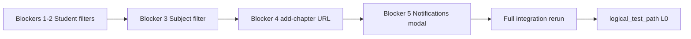

# Five Blockers First — Then logical_test_path L0

> Copy in repo: `edaya_web/docs/reference/five-blockers-then-logical-path.md`  
> Related: QA integration blockers plan (Cursor) + logical_test_path L0.

**Latest run:** 169 OK | **5 NOT OK** | 133 N/A (`edaya_web/apps/webapp/.integration-run/summary.json`).



**Policy:** Harness + setup fixes first (`scripts/`, `tests/integration/setup/`). Product change only where URL/modal logic is genuinely broken (notifications `document` gate).

---

## Checklist

- [x] **B1–B2** — `setupFilterStudents`: 3 status students + `studentsByClass`; fix `filter-setup-registry.ts`
- [x] **B3** — `setupFilterSubjects`: real `subjectId`, correct `gradeLevelId`
- [x] **B4** — `entities.subjectId` for `?modal=add-chapter` URL resolution
- [x] **B5** — Notifications modal: `editKey` without `document` gate + harness wait
- [ ] **Verify** — `bun run test:integration:provisioned` → 0 NOT OK on 5 rows (last good run: 165 OK, 1 NOT OK notifications, class/status N/A pending setup)
- [ ] **Then L0** — `mergeEntities`, fail-fast, `students.list` + `schoolId`

---

## Blocker 1 — École `Filtre classe`

**Symptom:** `Class filter missing student E2E-Search-{ts}`

**Root cause:**

- `filter-setup-registry.ts` asserts `searchToken` on class-filtered list.
- Search student is not assigned to `entities.classId`.
- `studentsByClass` fixture is never populated.

**Fix:**

| Step | File | Change |
|------|------|--------|
| 1 | `tests/integration/setup/filter-setup.ts` | Create student in class A (`entities.classId`); store `filterFixtures.studentsByClass[classId]` |
| 2 | `scripts/filter-setup-registry.ts` | Assert `studentsByClass[classId].lastName`, not `searchToken` |

**Acceptance:** `✓ [École] Filtre classe`

---

## Blocker 2 — École `Filtre statut`

**Symptom:** `Active filter missing E2E-Search-{ts}`

**Root cause:** Only one student created; need three (active / inactive / archived) with distinct last names.

**Fix:**

| Step | File | Change |
|------|------|--------|
| 1 | `filter-setup.ts` | Create `E2E-Active-*`, `E2E-Inactive-*`, `E2E-Archived-*` |
| 2 | `filter-setup.ts` | Populate `studentsByStatus.{active,inactive,archived}` |
| 3 | `filter-setup-registry.ts` | Assert each status filter shows correct fixture |

**Acceptance:** `✓ [École] Filtre statut`

---

## Blocker 3 — Configuration `Filtre niveau`

**Symptom:** `Subject E2E-Subject-{ts} not visible for level`

**Root cause:** Grade select uses `index: 0` but fixture keyed by `gradeLevelId`; `subjectId` set to name not UUID.

**Fix:**

| Step | File | Change |
|------|------|--------|
| 1 | `filter-setup.ts` | `selectOption` with `entities.gradeLevelId` |
| 2 | `filter-setup.ts` | After create, resolve real `subjectId` from list link |
| 3 | `filter-setup.ts` | `subjectsByGradeLevel[gradeLevelId] = { id, name }` |

**Acceptance:** `✓ [Configuration] Filtre niveau`

---

## Blocker 4 — Configuration `?modal=add-chapter`

**Symptom:** Redirect to `/configuration/subjects` (no subject id in URL).

**Root cause:** `resolveEndpoint` needs `entities.subjectId` (UUID); setup stored display name.

**Fix:**

| Step | File | Change |
|------|------|--------|
| 1 | `filter-setup.ts` | Set real `entities.subjectId` (blocker 3) |
| 2 | `qa-matrix-scenarios.ts` | N/A if `subjectId` missing (not NOT OK) |
| 3 | `qa-matrix-support.ts` | `mergeEntities`: setup ids win over discover |

**Acceptance:** `/configuration/subjects/{uuid}/progression?modal=add-chapter` opens dialog.

---

## Blocker 5 — Configuration `notifications?modal=edit`

**Symptom:** Modal not visible with `modalTarget=report_card.published`.

**Root cause:** `NotificationTemplatesList.svelte` closes edit modal when `document` not loaded yet.

**Fix (harness first):**

| Step | File | Change |
|------|------|--------|
| 1 | `qa-matrix-scenarios.ts` | `waitForPageQuery` + wait for template list before dialog assert (15s) |

**Fix (product if needed):**

| Step | File | Change |
|------|------|--------|
| 2 | `NotificationTemplatesList.svelte` | Defer `modals.close()` until `document` loads when target is valid |

**Acceptance:** `✓ [Configuration] Modal deep-link ?modal=edit` on notifications.

---

## Verification

```powershell
cd edaya_web/apps/webapp
$env:PLAYWRIGHT_BROWSERS_PATH="c:\Projets_perso\MAYA-EDU\MAYA-DEMO-CLIENT\.playwright-browsers"
bun run test:integration:provisioned
bun run qa:report:detailed
```

| Metric | Target |
|--------|--------|
| NOT OK on 5 blocker rows | **0** |
| OK count | **≥ 174** |

---

## Then — logical_test_path L0

After verification gate passes:

| Task | Purpose |
|------|---------|
| `mergeEntities(setup, discover)` | Setup IDs never overwritten |
| Setup fail-fast | Stop on `academic-year` failure |
| `students.list` + `schoolId` | Fix student CRUD / report-card N/A |
| Extend `MatrixEntities` | Prep for L1 workflows |

---

## Files to change

| File | Blockers |
|------|----------|
| `edaya_web/apps/webapp/tests/integration/setup/filter-setup.ts` | 1–4 |
| `edaya_web/apps/webapp/scripts/filter-setup-registry.ts` | 1–3 |
| `edaya_web/apps/webapp/scripts/qa-matrix-support.ts` | 4 |
| `edaya_web/apps/webapp/scripts/qa-matrix-scenarios.ts` | 4–5 |
| `edaya_web/apps/webapp/scripts/qa-harness-ui.ts` | 5 (optional) |
| `edaya_web/apps/webapp/src/routes/(app)/configuration/notifications/components/NotificationTemplatesList.svelte` | 5 (if harness insufficient) |
