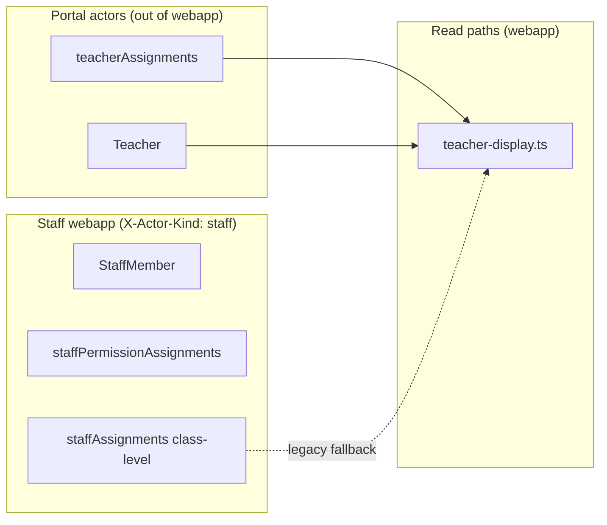
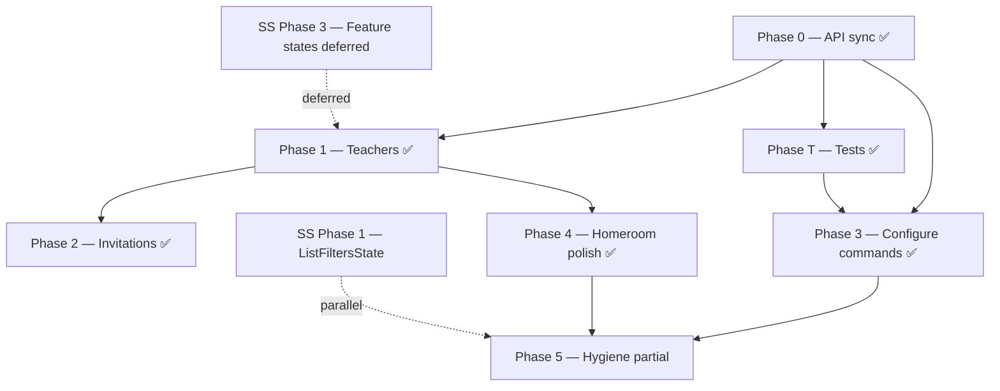

# Backend Alignment — Staff Webapp Sprint Plan

> **ARCHIVED** 2026-07-06 — Superseded by [demo-ready-plan.md](../demo-ready-plan.md). Kept for history. Do not execute items from this doc unless pulled into the demo plan.

> **Status:** **Phases 0, T, 1, 2, 3, 4 complete** — Phase 5 partial — **Svelte state alignment complete (SS 0–4, 1.9, 2.8)**  
> **Created:** 2026-07-05  
> **Last updated:** 2026-07-06  
> **Scope:** Close the gap between **edaya_backend** (relationship-native auth, teacher model, configure-* commands, teacher authorization) and **apps/webapp** after v1 shell delivery (Phases 0–8); align state architecture with [svelte-state-spec.md](../specs/svelte-state-spec.md)  
> **Out of scope:** Service catalog finance rewrite, platform limits / `webadmin`, resource management UI, teacher mobile app  
> **Related backend:** [relationship-native-auth-plan.md](../../../edaya_backend/docs/sprints/relationship-native-auth-plan.md) · [service-catalog-plan.md](../../../edaya_backend/docs/sprints/service-catalog-plan.md)  
> **Related web:** [v1-staff-webapp-implementation-plan.md](./v1-staff-webapp-implementation-plan.md) · [svelte-state-alignment.md](./svelte-state-alignment.md) · [ui-architecture-reference.md](../../reference/ui-architecture-reference.md) §6.1

This plan follows the **v1 staff webapp** (interaction shell complete) and addresses **API / domain drift** introduced when the backend shipped Fold A–F (teachers ≠ staff, multi-profile auth, workflow commands) plus recent **teacher authorization** capabilities (`40b00086`).

---

## Sprint status (2026-07-06)

**On track.** All work shipped in this sprint stays within the original scope: close backend ↔ webapp drift for the **staff webapp**, not mobile apps, not service catalog, not webadmin.

| Area | Verdict |
|------|---------|
| **Teachers ≠ staff** | ✅ Teachers directory, portal invites, display resolution — no new `registerStaffMember` teacher path |
| **Configure-* commands** | ✅ Staff permissions, subjects, grade levels, periods, discipline, activities, activity enrollments use workflow commands |
| **Homeroom dual model** | ✅ Portal teacher (`teacherAssignments`) vs staff coordinator (`homeroomStaffId`) documented in UI |
| **Test infra** | ✅ `tests/` layout, state-action tests, **252 tests passing** |
| **Deferred by design** | ~~Tier-2 `*-state.svelte.ts` (1.9, 2.8)~~ ✅ — `relinkActorSubject` (3.5), attendance justification (3.6), multi-school header (5.2) |

**Not drift:** Activity enrollment **remove** uses `entities.activityEnrollments.delete` (no withdraw command on backend). `configureSubjectMatter` not wired — no subject-matter CRUD UI in webapp yet.

### Remaining (optional / blocked)

| ID | Item | Blocker |
|----|------|---------|
| 1.9, 2.8 | Tier-2 state classes | ✅ Shipped 2026-07-06 |
| 3.5 | `relinkActorSubject` | No multi-profile account-linking UI |
| 3.6 | `requestAttendanceJustification` | No justification UI |
| 5.2 | `X-School-Id` header | Backend multi-school staff sessions |
| 5.3 | §6 gap table row-by-row cleanup | Docs hygiene — banner added |
| 5.5 | demo-ci `teacher-display` integration test | Optional |
| SS 1–4 | List filter primitive, drawer context, feature states | ✅ Shipped 2026-07-06 |

---

## Progress tracker

Living checklist — check items off (`[x]`) as work lands. Mirror updates in [ui-architecture-reference.md §0](../reference/ui-architecture-reference.md#v1-progress-tracker) backend blockers.

### Phase 0 — API sync & read-path fixes *(shipped 2026-07-05)*

- [x] **B5** — Regen OpenAPI client (`openapi.json` + `bun run openapi:generate`)
- [x] **B6** — Teacher display from `teacherAssignments` + `teachers` (`teacher-display.ts`; timetable · subjects · logbook · report cards; staff fallback)
- [x] **B7** — `X-Actor-Kind: staff` on browser transport (+ profile upload headers)
- [x] Unit tests for `teacher-display` and updated data-loader fixtures
- [x] OpenAPI bindings in sync with backend as of 2026-07-05 (no path drift vs `tooling/repo/fixtures/openapi.json`)

### Phase T — Test infrastructure & state-action coverage *(shipped 2026-07-05)*

> Normative layout per [svelte-state-spec.md](../specs/svelte-state-spec.md) § Testing — state classes and store actions are plain TypeScript; unit-test without mounting Svelte.

- [x] **T.1** — All `*.test.ts` under `apps/webapp/tests/` (mirrors `src/` paths; no tests in `src/`)
- [x] **T.2** — Shared harness in `tests/support/` (`sveltekit-mocks.ts`, `openapi-fixtures.ts`, `recording-school-client.ts`)
- [x] **T.3** — `$tests` alias in `svelte.config.js` + `tsconfig.test.json`; `bun test tests` in `package.json`
- [x] **T.4** — Entity store seed/action tests: `tests/lib/detail-data/context.test.ts`, `context-actions.test.ts`
- [x] **T.5** — Query → store contract tests: `tests/lib/queries/query-store-actions.test.ts` (`resolvePageLoad` + class-scoped seed)
- [x] **T.6** — Mutation apply/rollback tests: `tests/lib/api/mutations/mutation-store-actions.test.ts` (`runMutation` + staff-permission patch contract)
- [x] **T.7** — Fix academic admin list URL filter codec tests (`status: 'all'` default)
- [x] **T.8** — Add `tests/README.md` documenting layout, `$tests` imports, and `.svelte.ts` testing convention (mirror pure helpers; mock bootstrap/toast when importing `runMutation`)

**Test layout (locked):**

```
apps/webapp/
  tests/
    support/           # preload mocks, fixtures, recording client
    lib/               # mirrors src/lib/
    generated/         # api-client tests
  src/                 # production code only — no *.test.ts
```

### Phase 1 — Teachers directory (staff-facing admin) *(shipped 2026-07-05)*

> Backend: `Teacher` + `TeacherAssignment` entities and CRUD are live. `40b00086` adds teacher capabilities to authorization — web gates teacher admin routes with `STAFF_READ` / `STAFF_CREATE` / `STAFF_UPDATE`.
- [x] **1.1** — **Teachers** sub-area under School: list route `/school/teachers/[[id]]`
- [x] **1.2** — **Simple/complex classification:** `Teacher` = complex drawer (profile + assignments tab)
- [x] **1.3** — `TeacherFormModal` — create/edit via `teachers` entity save
- [x] **1.4** — **Assignments tab** — list of `teacherAssignments`; `+ Add` → modal (`kind: subject | homeroom`)
- [x] **1.5** — Mutations: `teacherAssignments.save` / delete; list invalidates via infinite fetch on change
- [x] **1.6** — Nav gating: `STAFF_READ` (create/update: `STAFF_CREATE` / `STAFF_UPDATE`)
- [x] **1.7** — i18n (FR/EN) for teacher roles, assignment kinds, empty states
- [x] **1.8** — Update [v1-feature-architecture-spec](../specs/feature-architecture-spec.md) route index + [ui-architecture-reference](../reference/ui-architecture-reference.md) entity map (`teachers`, `teacherAssignments`)
- [x] **1.9** — **Tier-2 state:** `lib/school/teachers-state.svelte.ts` + `ListFiltersState` filters

### Phase 2 — Invitations & onboarding alignment *(shipped 2026-07-06)*

> Stop creating portal teachers via `registerStaffMember` + `professeur` preset.

- [x] **2.1** — `sendAccountInvitation` with `kind: 'teacher'` wired in invitation mutations (types already in OpenAPI)
- [x] **2.2** — **Teacher create flow** — create `Teacher` row, then invite with `targetId = teacher.id`
- [x] **2.3** — **Staff create flow** — unchanged (`kind: 'staff'`); remove implicit “teacher” staff role from `StaffCreateModal` copy where misleading
- [x] **2.4** — **Onboarding staff invites** — split “Teacher (portal)” vs “Staff (workspace)” in `staff-invite-profiles.ts`; map onboarding `teacher` role → `Teacher` entity + `kind: teacher` invite (not `registerStaffMember`)
- [x] **2.5** — Invite accept page — `actorKind` label for `teacher` + post-accept teacher-app message (no staff webapp redirect)
- [x] **2.6** — Account linking section — support resend/revoke for `teacher` invitations
- [x] **2.7** — Seed/demo docs: document `a.toure@` / `k.diomande@` as teacher-only accounts (no webapp) — [demo-accounts.md](../reference/demo-accounts.md)
- [x] **2.8** — **Tier-2 state:** `onboarding-wizard-state.svelte.ts` — thin `onboarding/+page.svelte`

### Phase 3 — Configure-* command migration *(shipped 2026-07-06)*

> Backend added workflow commands with validation gates. Direct entity saves still work (`allowDirectSave: true`) but commands are the supported path.

| Web mutation (was) | Command (now) | Status |
|--------------------|---------------|--------|
| `staffPermissionAssignments.save` | `assignStaffPermission` | ✅ |
| `subjects.save` (+ `offerSubjectToClass` for class offer) | `configureSubject` | ✅ |
| `subjectMatters.save` | `configureSubjectMatter` | — no webapp UI yet |
| `gradeLevels.save` | `configureGradeLevel` | ✅ |
| `periodDefinitions.save` | `configurePeriodDefinition` | ✅ |
| `disciplinaryActions.save` | `configureDisciplinaryAction` | ✅ |
| `activities.save` | `configureActivity` | ✅ |
| `activityEnrollments.save` | `enrollStudentInActivity` | ✅ add + status |
| `activityEnrollments.delete` | *(no command)* | ✅ remove via entity delete |

- [x] **3.1** — `assignStaffPermission` in `staff-permission-assignments.mutations.ts`
- [x] **3.2** — `configureSubject` in `subject.mutations.ts` (`offerSubjectToClass` unchanged for class offer). `configureSubjectMatter` deferred — no subject-matter admin mutations
- [x] **3.3** — Grade level, period definition, disciplinary, activity mutations
- [x] **3.4** — `enrollStudentInActivity` for add/status; remove via `activityEnrollments.delete` in `activity-enrollment.mutations.ts`
- [ ] **3.5** — `relinkActorSubject` — only if account-linking UI needs it (multi-profile staff+teacher)
- [ ] **3.6** — `requestAttendanceJustification` — wire when guardian/staff justification UI lands
- [x] **3.7** — Extend `mutation-store-actions.test.ts` when each command migration lands (apply/rollback on entity store) — activity enrollment patch test added

### Phase 4 — Homeroom & display polish *(shipped 2026-07-06)*

> `ClassGroup.homeroomStaffId` (staff coordinator) coexists with `TeacherAssignment` homeroom (portal teacher). Demo-ci uses both.

- [x] **4.1** — **Homeroom display** — class config drawer: show portal homeroom teacher from `teacherAssignments` (`kind: homeroom`) when present; keep `homeroomStaffId` staff picker for coordinator role
- [x] **4.2** — **Homeroom attendance nudge** — consider `teacherAssignments` homeroom in addition to `homeroomStaffId` (or document staff-only nudge as intentional)
- [x] **4.3** — **Staff drawer assignments tab** — clarify label: class-level **staff** assignments only (not subject teachers)
- [x] **4.4** — Remove or soften **`professeur`** heuristic in `staff-data.ts` / `permissions.ts` (teaching role is no longer a staff permission bundle)

### Phase 5 — Hygiene & cross-repo workflow *(partial)*

- [x] **5.1** — Fix **academic admin** list URL filter codec tests (`status: 'all'` default; moved to `tests/lib/list/`)
- [ ] **5.2** — Add `X-School-Id` header when multi-school staff sessions are supported (pair with backend session resolution) — **blocked on backend**
- [x] **5.3** — §6 gap table: historical banner in [ui-architecture-reference](../reference/ui-architecture-reference.md) (full row-by-row reconcile optional)
- [x] **5.4** — Pair PR workflow — [cross-repo-workflow.md](../reference/cross-repo-workflow.md) + root `README.MD` link
- [ ] **5.5** — Optional: `teacher-display` integration test against `demo-ci` fixture IDs (`ci-t1`, `ci-cs-6a-math`)

---

## Svelte state alignment (parallel track)

> Full tracker: [svelte-state-alignment.md](./svelte-state-alignment.md) · Normative: [svelte-state-spec.md](../specs/svelte-state-spec.md)

Cross-cutting with Phases 1–4 — migrate on touch; **new screens must follow spec from day one**.

### SS Phase 0 — Guardrails

- [x] `docs/specs/svelte-state-spec.md`
- [x] `.cursor/rules/svelte-state.mdc`
- [x] Link in `AGENTS.md`
- [x] State-action unit tests for entity store, queries, mutations (Phase T)
- [x] Add § "State alignment" checklist to [ui-architecture-reference.md](../reference/ui-architecture-reference.md) §0

### SS Phase 1 — Shared list filter primitive

- [x] `lib/list/list-filters-state.svelte.ts` — remove duplicated URL ↔ filter boilerplate from ~20 views
- [x] Pilots: `FeesView`, `StudentsView`, `PaymentsView`

### SS Phase 2 — Context normalization

- [x] `DrawerState` → Symbol context key (`drawer-context.ts`)
- [x] Extract `planning-timetable-state.svelte.ts` from `ClassTimetableCalendar` inline context

### SS Phase 3 — Feature state classes (priority) *(shipped 2026-07-06)*

| Feature | Module | Status |
|---------|--------|--------|
| Teachers directory | `lib/school/teachers-state.svelte.ts` | ✅ |
| Onboarding wizard | `lib/onboarding/onboarding-wizard-state.svelte.ts` | ✅ |
| Planning / timetable | `lib/scheduling/planning-state.svelte.ts` | ✅ |
| Timetable calendar | `lib/scheduling/planning-timetable-state.svelte.ts` | ✅ |
| School students list | `lib/students/school-students-state.svelte.ts` | ✅ |

**Exit per feature:** thin `*View.svelte` scripts; `tests/lib/<domain>/*-state.test.ts` for non-trivial Tier-2 logic.

### SS Phase 4 — Data-loading boundary audit

- [x] No new `$effect` + API fetch in views (grep audit 2026-07-06 — clean)
- [x] Feature state reads `detailDataContext` — no duplicate entity arrays (P0 states)

---

## Post-v1 / backend-blocked (track only)

Check when backend sprints land — do not start web work until API entities exist.

### Service catalog (finance)

- [ ] Backend: `CatalogService`, `StudentYearAccount`, `StudentCharge`, `Allocation` ([service-catalog-plan](../../../edaya_backend/docs/sprints/service-catalog-plan.md))
- [ ] Web: replace Fees / Billing UX with catalog → enrollment → charges → account → payments
- [ ] Mobile guardian: opt-in catalog + approval flows

### Platform limits (`webadmin`)

- [ ] Backend: plan / entitlement model ([platform-limits-and-plans-plan](../../../edaya_backend/docs/sprints/platform-limits-and-plans-plan.md))
- [ ] Web: `apps/webadmin` plan management (out of `webapp` scope)

### Resources

- [ ] Post-v1 staff UI for `resources` / `resourceAssignments` (deferred in v1 spec)

---

## Architecture notes (locked)



| Decision | Rule |
|----------|------|
| Webapp actor | Always `staff`; never impersonate `teacher` in staff UI |
| Teacher labels | `teacherAssignments` first; `staffAssignments.classSubjectId` fallback for legacy data |
| Teacher CRUD | New School module (Phase 1); not folded into Staff drawer |
| Staff permissions | `staffPermissionAssignments` only; no `professeur` preset |
| OpenAPI drift | Re-run Phase 0 B5 after every backend API merge |
| Entity data | Tier 1 `detailDataContext` — queries seed, mutations patch via `runMutation` |
| Test location | `apps/webapp/tests/` only; support in `tests/support/` |
| `.svelte.ts` in tests | Test pure helpers / seed policies; mock bootstrap when importing `runMutation` |

---

## Verification (per phase)

Before merging each phase:

```sh
cd edaya_web/apps/webapp
bun test tests                 # 252 tests (2026-07-06)
bun run check
cd ../.. && bun run verify     # from web repo root when available
```

Manual smoke (against `demo-ci` seed):

1. Timetable / Lessons show **Mme Touré** on maths (6ème A)
2. Staff login (`j.aka@`) — full webapp; no auth errors
3. Teacher-only login (`a.toure@`) — no staff webapp access (expected)
4. Staff drawer permissions — assign/revoke still works after `assignStaffPermission` migration

---

## Dependency order



**Execution (2026-07-06):** Phases 0–4 are **done** for backend-alignment purposes. Remaining work is optional hygiene (5.5), backend-blocked items (5.2, 3.5–3.6), or the **Svelte state** parallel track (not required to close API drift).

---

## References

| Doc | Purpose |
|-----|---------|
| [cross-repo-workflow.md](../reference/cross-repo-workflow.md) | OpenAPI export & pair PR |
| [demo-accounts.md](../reference/demo-accounts.md) | Local staff vs portal-teacher logins |
| [ui-architecture-reference §6.1](../reference/ui-architecture-reference.md#61-backend-blockers) | Blocker IDs B1–B7 |
| [relationship-native-auth-plan](../../../edaya_backend/docs/sprints/relationship-native-auth-plan.md) | Teacher vs staff model (normative backend) |
| [svelte-state-spec.md](../specs/svelte-state-spec.md) | Tier 1/2/3 state architecture |
| [svelte-state-alignment.md](./svelte-state-alignment.md) | State migration tracker |

---

## Document history

| Date | Change |
|------|--------|
| 2026-07-05 | Initial plan (Phase 0 shipped) |
| 2026-07-05 | Phase T (test reorg + state-action tests); SS alignment track; backend `40b00086` teacher auth; 5.1 fixed |
| 2026-07-06 | Phases 1–4 shipped: teachers directory, portal invites, configure-* commands, homeroom display, activity enrollments; docs (demo-accounts, tests/README); plan status refresh |
