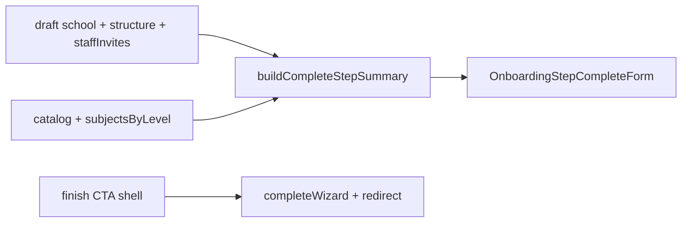

# Onboarding step 4 — summary screen (archived)

> **Status:** Complete  
> **Scope:** Replace step-4 checklist with a read-only synthesis; then compact nested Structure with chapters  
> **Package:** `edaya_web/apps/webapp` onboarding  
> **Merged from:** `.cursor/plans/step4_summary_screen_8e364cef.plan.md` + `compact_nested_summary_84c4f9a4.plan.md`

## Goal

Step 4 shows **what will be available** (school, structure, team) before opening the dashboard — not a premature “suggested next steps” checklist. Edit stays disabled until Back / step navigation is reliable.

## Phase A — Summary screen (not checklist)

### Rationale

The checklist was premature. A **summary of what is ready** plus **Open dashboard** is the right job for step 4.

### Summary scope

- Compact **school identity** line (name · city · country) from step 1.
- **Structure** from step 2: configured levels (`classCount >= 1`), class name previews, subjects from the structure-template catalog.
- **Team invitations** from step 3: complete invites only (email + role). Empty state when none.
- No post-onboarding checklist on this screen.

### Approach



#### 1. Enrich catalog for subjects

In [`structure-template-catalog.ts`](../../../apps/webapp/src/lib/onboarding/structure-template-catalog.ts):

- `subjectsByGradeLevelId: Map<string, Array<{ code; name }>>` from `template.curriculum` + `template.subjects`.
- Helper `subjectsForGradeLevelIds(catalog, ids)` → unique by `code`.

#### 2. Summary helper

New [`complete-step-summary.ts`](../../../apps/webapp/src/lib/onboarding/complete-step-summary.ts) (replaces checklist):

- `schoolLine`, flat `levels[]` / `classes[]` / `subjects[]`, `staffInvites[]`, aggregate counts.
- Unit tests: zero-count levels excluded; class preview; subject dedupe; incomplete staff rows dropped.

#### 3. Step-4 UI (v1)

Rewrite [`OnboardingStepCompleteForm.svelte`](../../../apps/webapp/src/routes/onboarding/components/OnboardingStepCompleteForm.svelte):

- Four blocks: Levels / Classes / Subjects / Team; Edit disabled with `data-step` stubs.
- Delete `complete-step-checklist.ts` if unused.
- Load catalog via `loadStructureTemplateCatalog(country)`.

Shell footer unchanged: **Open dashboard**.

#### Todos (Phase A) — all done

- [x] Extend catalog with `subjectsByGradeLevelId` + unique-subject helper
- [x] Create `complete-step-summary.ts` + unit tests
- [x] Rewrite CompleteForm with summary sections + disabled Edit; i18n; remove checklist
- [x] Autofixer + run summary/catalog tests

---

## Phase B — Compact nested Structure

### Problem after Phase A

Four separate wide lists hid inheritance (classes belong to a level) and did not show **chapters** (`matters`).

### Chosen visual

**Nested Structure** inside one card — School and Team stay thin peer blocks.

```text
School
  Collège X · Abidjan · Côte d'Ivoire          [Edit disabled]

Structure                                      [Edit disabled]
  ┌─ 6EME · 2 classes
  │    Classes: 6EME 1 · 6EME 2
  │    MATH — Arithmétique… ; Fractions…  (+7)
  │    FR — Lecture… ; Grammaire…         (+2)
  └─ 5EME · 1 class
       Classes: 5EME 1
       FR — Grammaire…                    (+3)

Team                                           [Edit disabled]
  email · profile
```

Design rules (plan):

- Compact denser type; Structure scroll `max-h-[min(48vh,22rem)]`.
- Level = parent; classes inline under level; subjects under that level only with first 2 chapter titles + `+N`.
- Flat global subject list removed; shell `max-w-2xl` unchanged.

### Data changes

- Extend `CatalogSubject` with `matters: string[]` when building the catalog.
- Level-centric summary model:

```ts
levels: Array<{
  gradeLevelId, code, model, classCount,
  classNames: string[],
  subjects: Array<{ code, name, matters: string[] }>
}>
```

- Drop flat `classes[]` / `subjects[]` from the public summary; keep `schoolLine`, `staffInvites`, aggregate counts.
- `previewMatters(matters, 2)` → `{ preview, more }`.

### Todos (Phase B) — all done

- [x] Add `matters[]` to `CatalogSubject` when building `subjectsByGradeLevelId`
- [x] Rewrite `complete-step-summary` to level-centric rows + tests
- [x] Rewrite CompleteForm: nested Structure; thin School/Team; i18n
- [x] Autofixer + run `complete-step-summary` tests

---

## As shipped (follow-ups after Phase B)

UI refinements landed in the same screen after the nested plan:

- Structure: **level cards** with a **subject table** (Code / Subject / Chapters); row click opens chapters drawer.
- Chapters drawer matches configuration **SubjectDrawer** shell (`DrawerEntityHeader` + chapter cards), read-only.
- Team: **Email / Profile** table for multi-invite scanability.

## Out of scope (at archive time)

- Enabling Edit / Back navigation between steps → **done later** in [onboarding-navigation-and-edit-plan.md](./onboarding-navigation-and-edit-plan.md).
- Changing shell width or finish CTA.
- Restoring a post-dashboard checklist.
