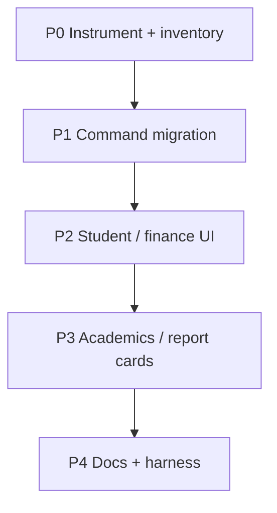

# Webapp ↔ API / domain drift plan

> **Status:** On-going — investigation complete; execution not started  
> **Created:** 2026-07-23  
> **Scope:** Close gaps where `apps/webapp` drifted from `edaya_backend` core entities, workflow commands, and feature-architecture §6  
> **Out of scope:** Portal mobile apps, resource UI (post-v1), service catalog finance rewrite, webadmin  

**Normative:** [feature-architecture-spec.md](../../specs/feature-architecture-spec.md)  
**Related:** [backend-alignment-plan.md](../archive/backend-alignment-plan.md) (archived) · [remaining-work-plan.md](../archive/remaining-work-plan.md) · [cross-repo-workflow.md](../../reference/cross-repo-workflow.md)  
**Harness:** `bun run demo:e2e` → `apps/webapp/tests/integration/demo-dry-run/`

---

## Verdict

| Layer | Status |
|-------|--------|
| Routes vs feature-architecture §6 | Mostly aligned (legacy redirects OK) |
| Nav catalog | Aligned; extras intentional or stubs |
| API commands | **71 / 114** used by webapp |
| Preferred-command discipline | **Bypasses** — creates often use commands; updates often use `entities.*.save` |
| Playwright dry-run | Strong route/drawer smoke; weak command-contract coverage |

Route tree matches §6. Primary drift is **mutation path** (entity save vs workflow command) and **API-ready capabilities with no staff UI**.

### Hot finding — `serviceOnly` misuse

Webapp calls **`assignMatterToClassSubject`** from chapter/subject-matter flows (`save-chapter-for-class-subject.ts`, `subject-matter.mutations.ts`). That command is registered **`serviceOnly: true`** in the school API registry — staff actors should be rejected. Prefer `assignMatterToGradeLevelSubject` + class sync, or a staff-allowed path. Track under **P1**.

---

## 1. Route inventory notes

### Spec §6 — present
Dashboard · School (students/guardians/staff/teachers/calendar/activities/announcements/events) · Classes (students/timetable/teaching/evaluations/report-cards/attendance) · Finance (fees/billing/payment) · Configuration (school/academic/grade-levels/classes/subjects/report-cards/grade-scales/notifications/discipline) · Account inbox.

### Extra (not in §6)
| Route | Notes |
|-------|-------|
| `/configuration/tools` (+ `…/teacher-assignments`) | Imports + timetable orchestration — keep; document in §6 or tools plan |
| `/account/notifications` | Notification contact settings — keep |
| `/school/teacher-assignments` | **Empty stub** (`+page.svelte` is 0 bytes); not in nav. Real hub: `/configuration/tools/teacher-assignments` |

### Legacy redirects (OK)
`/classes/…/homework` → evaluations · `/configuration/roles` → staff · `/configuration/staff` → `/school/staff` · `/classes/…/subjects` → teaching.

### Docs hygiene
`ui-architecture-reference.md` §9 still marks some entities Gap/Partial that already ship (enrollments tab + transfer; incident sanctions). Reconcile in P4.

---

## 2. Backend constraints that change the gap list

From `edaya_backend` command/entity catalogs:

### Command-only entities (`allowDirectSave: false`)
HTTP `save` / `batch-save` return **405** — staff UI **must** use commands:

`accountInvitations`, `studentFees`, `payments`, `schoolNotificationTemplates`, `gradeLevelSubjects`, `gradeLevelSubjectMatters`, `classSubjects`, `assessmentResults`, `results` (report cards), `students`, `enrollments`

### Prefer commands even when entity save is allowed
Backend still exposes entity save for many types (`allowDirectSave: true`), but workflow commands add validation gates. Webapp should prefer commands for school configuration, staff assignment, fees create path, assessments create, etc.

### `serviceOnly` commands (staff UI must not call)
From `apps/api` registry — interactive staff actors get rejected:

`acceptAccountInvitation`, `offerSubjectToClass`, `assignMatterToClassSubject`, `materializeDeliveries`, `applyDeliveryEvent`

Staff subject/matter flows should use grade-level / custom-class paths (`offerSubjectToGradeLevel`, `addCustomClassSubject`, `assignMatterToGradeLevelSubject`, …) or entity paths that are allowlisted for staff.

### Not staff-webapp gaps
| Surface | Reason |
|---------|--------|
| `registerPushDevice` / delivery plumbing | Portal / service |
| Resource assign/configure commands | Post-v1 by spec |
| `acceptAccountInvitation` | Invite page uses `public.acceptInvitation` |
| Attendance justification commands | Tracked blocked (no UI yet) |
| Multi-school `X-School-Id` | Backend-blocked |

---

## 3. Gap catalog

### A. Preferred-command bypasses (P1)

| UI path | Today | Preferred |
|---------|-------|-----------|
| School profile / timetable prefs | `entities.schools.save` | `updateSchoolConfiguration` |
| Class staff assignments | `entities.staffAssignments.save` | `assignStaffToClass` / `assignStaffToClassSubject` |
| Fee edit | `entities.fees.save` | Align with `createFee` command path (or document exception) |
| Assessment edit/delete | `entities.assessments.save/delete` | Prefer command updates where available |
| Calendar edit | `entities.calendarEvents.save` | create uses `createCalendarEvent` |
| Schedule updates | mixed | Prefer `saveSchedule` where applicable |

### B. API-ready, staff UI missing (P2–P3)

| Domain | Unused / underused commands | Target surface |
|--------|-----------------------------|----------------|
| Student lifecycle | `promoteStudent`, `graduateStudent`, `closeEnrollment`, `updateStudentStatus` | Student → Enrollments (`transferStudent` already wired) |
| Health | `upsertStudentHealthProfile` | Profile health is **read-only** |
| Finance ops | `adjustStudentFee`, `cancelStudentFee`, `cancelPayment`, `reversePayment` | Billing / Payments row `···` |
| Report cards | `writeHomeroomReportComment`, `createReportCardDefinitionSection` | Report-card drawers / definition editor |
| Subjects catalog | `setClassSubjectOffered`, `removeSubjectFromGradeLevel`, `updateGradeLevelSubject` | Subjects / grade-level flows |
| Assessments | `completeAssessment`, `recordAssessmentResultCompliance`, `listClassSubjectAssessmentResultsForPeriod` | Evaluations drawer |
| Progression | `recordProgressionDecision` | Teaching progression |
| Discipline | `updateStudentDisciplinaryActionStatus` | Incident post-resolve |
| Attachments | `removeAttachment` | Profile / cleanup |

### C. Hygiene / stubs
| Item | Action |
|------|--------|
| Empty `/school/teacher-assignments` | Redirect to tools hub or delete route |
| Export More-menu stubs | Product decision — keep stub or implement |
| Homework file attach stub | Product decision |
| `report-card-pdf.ts` `as never` filter cast | Fix attachment list typing |

---

## 4. Playwright expansions

Existing: route smoke, drawer tabs, list shell, modals, import/tools, finance/guardian drawers, owner permissions, homeroom.

| Scene ID | Assert |
|----------|--------|
| `DR-cmd-school` | Edit school → `POST …/commands/update-school-configuration` |
| `DR-cmd-staff-assign` | Add class assignment → `assign-staff-to-class` |
| `DR-cmd-fee` | Fee edit does not silently use disallowed paths |
| `DR-lifecycle` | Promote/close from enrollments (after P2) |
| `DR-report-pdf` | Publish → attachment `ownerKind=report_card` → download URL |
| CI inventory | OpenAPI commands classified: `wired` \| `bypass` \| `no-ui` \| `out-of-scope` |

Also: optionally fail dry-run steps on school API ≥400 (small 403 allowlist for enrichment).

---

## 5. Execution phases

### P0 — Instrument
- [ ] Command inventory test: OpenAPI → classify each command (`wired` / `bypass` / `no-ui` / `out-of-scope`)
- [ ] Playwright network helper: assert mutation scenes hit `/core/commands/…` when expected
- [ ] Optional: fail dry-run on school API ≥400 (allowlist known 403 enrichment)

### P1 — Command migration
- [ ] **Fix `assignMatterToClassSubject` misuse** (serviceOnly) → staff-allowed matter assignment path
- [ ] School settings → `updateSchoolConfiguration`
- [ ] Staff class assignments → `assignStaffToClass` / `assignStaffToClassSubject`
- [ ] Fee / assessment / calendar / schedule update paths — migrate or document exception
- [ ] Unit tests + dry-run network asserts per migrated path

### P2 — Student & finance surfaces
- [ ] Enrollments: promote / graduate / close / status
- [ ] Health edit → `upsertStudentHealthProfile`
- [ ] Billing/payments: adjust / cancel / reverse via row `···`
- [ ] Dry-run scenes for each

### P3 — Academics & report cards
- [ ] Definition sections → `createReportCardDefinitionSection`
- [ ] Homeroom comment → `writeHomeroomReportComment`
- [ ] Subject offer/remove/update grade-level-subject where product needs them
- [ ] Progression decision + assessment complete/compliance as needed
- [ ] Remove `as never` from report-card PDF lookup

### P4 — Hygiene
- [ ] Redirect or delete empty `/school/teacher-assignments`
- [ ] Reconcile `ui-architecture-reference.md` §9 stale Gap rows
- [ ] Document `/configuration/tools` in feature-architecture §6 (or keep as tools-only layout variant)
- [ ] Keep OpenAPI sync ritual (backend export/generate → web `bun install` on linked client)

---

## 6. Progress

| Phase | Status |
|-------|--------|
| Investigation | ✅ 2026-07-23 |
| P0 | Not started |
| P1 | Not started |
| P2 | Not started |
| P3 | Not started |
| P4 | Not started |

---

## Document history

| Date | Change |
|------|--------|
| 2026-07-23 | Created from route + OpenAPI command audit + demo-dry-run coverage review |
