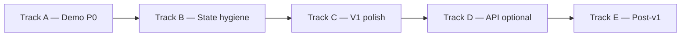

# Remaining Work — Staff Webapp

> **Status:** **Active** — extracted carry-over from archived sprint plans  
> **Created:** 2026-07-06  
> **Goal:** Single backlog for everything **not** closed when [v1](./archive/v1-staff-webapp-implementation-plan.md), [backend-alignment](./archive/backend-alignment-plan.md), and [svelte-state](./archive/svelte-state-alignment.md) were archived  

**Demo execution** (script, dry-run, scene checkboxes): **[demo-ready-plan.md](./demo-ready-plan.md)**  
**Normative specs:** [v1-feature-architecture-spec.md](../specs/v1-feature-architecture-spec.md) · [svelte-state-spec.md](../specs/svelte-state-spec.md)

### Portal actors vs webapp features

| Concern | Where | Guidance |
|---------|-------|----------|
| **Teachers / Students / Guardians UI** | `apps/webapp` | **In scope** — lists, drawers, invites, assignments must work (demo D2–D3). |
| **Portal sign-in** | `edaya_mobile` | Teachers/guardians/students authenticate on mobile; webapp does not host portal sessions. |
| **Permission / grant changes** | `edaya_backend` | **Regression risk** for portal authorization — assignment scopes, role presets, and seed grants can break what portal users can do in mobile apps even when staff webapp screens look fine. |

When changing backend permissions or staff role scopes, cross-check portal actors (see [demo-accounts.md](../reference/demo-accounts.md)) in addition to staff dry-run scenes.

---

## Why this plan exists

The three archived plans were marked “complete” at the phase level, but several **unchecked items, partial phases, and on-touch migrations** were never copied into an active tracker. This document is that tracker.

| Archived plan | Declared done | Actually still open |
|---------------|---------------|---------------------|
| **v1 staff webapp** | Phases 0–8 ✅ | Phase 8 polish, chip-bar inventory, drawer header rollout rows |
| **backend-alignment** | Phases 0–4, T ✅ | Phase 5 partial (5.2, 5.5), 3.5–3.6 deferred, `configureSubjectMatter` |
| **svelte-state** | SS 0–4, P0 ✅ | ListFilters rollout (~17 views), P1/P2 extractions, PR template, Phase 4 audit |

---

## Priority lanes

| Track | When | Source |
|-------|------|--------|
| **A** Demo blockers | Before demo | DR.1 dry-run + scene failures |
| **B** Svelte state carry-over | After A, on-touch | svelte-state-alignment Phases 1, 3–4 |
| **C** V1 polish | After demo or parallel | v1 Phase 8, §6 drawer rollout |
| **D** Backend optional / blocked | When unblocked | backend-alignment Phase 3.5–3.6, 5.x |
| **E** Post-v1 | Not demo | service catalog, saas-admin, resources |

---

## Track A — Demo blockers (P0)

From [demo-ready-plan.md](./demo-ready-plan.md) dry-run (2026-07-06). Fix before checking scenes D0–D11.

| ID | Task | Scene | Source | Status |
|----|------|-------|--------|--------|
| **A.1** | `ListFiltersState`: sync initial values before `bind:value` | D2, D3 | SS Phase 1 regression | **Done** |
| **A.2** | Shell bootstrap: omit stale year header; `resolvePageLoad` awaits shell | D0, D5–D10 | DR.1 | **Done** |
| **A.3** | Class sidebar: guard empty `classId`; demo-ci placeholder `ci-6a` | D5+ | v1 nav + DR.1 | **Done** |
| **A.4** | Finance routes load after shell ready | D9 | DR.1 | **Done** |
| **A.5** | Announcements: drop full-roster fetch on list load | D8 | DR.1 | **Done** |
| **A.6** | Student / teacher / config drawers tolerate 403 enrichment | D2, D3, D11 | DR.1 | **Done** |
| **A.7** | Timetable cell shows portal teacher name (not only subject) | D5 | DR.3 | **Done** — D5.2 automated (Mme Touré on grid) |
| **A.8** | Dashboard deep-links resolve to real lists | D1 | DR.4 | **Done** — `dashboard-links.ts`; D1.2 automated |

**Exit:** `node apps/webapp/scripts/demo-dry-run.mjs` passes (**52/52**, 4 skipped); manual spot-check of D4 permissions modals, D6 homework filter, D10 bulletin drawer.

**Track A status:** **Complete** (2026-07-06).

---

## Track B — Svelte state carry-over

From [svelte-state-alignment.md](./archive/svelte-state-alignment.md). **Not demo-blocking** unless a scene breaks.

### B.1 — ListFiltersState rollout (Phase 1 remainder)

Pilots + state-class views were already done. **Migrated 2026-07-06** to `ListFiltersState` in all remaining B.1 targets:

| View | Module | Status |
|------|--------|--------|
| `SchoolStudentsView` | School | ✅ via `school-students-state` |
| `TeachersView` | School | ✅ via `teachers-state` |
| `PlanningView` | Classes | ✅ via `planning-state` |
| `GuardiansView`, `StaffView` | School | ✅ |
| `EvaluationsView`, `ClassReportCardsView`, `AttendanceView` | Classes | ✅ (+ URL codecs for eval/attendance) |
| `AnnouncementsView`, `ActivitiesView`, `SchoolCalendarView` | School life | ✅ |
| `ClassGroupsView`, `DisciplinaryCatalogView`, `GradeScalesView`, `ConfigSubjectsView` | Configuration | ✅ |
| `EducatorDashboardView` | Dashboard | ✅ |
| `FeesView`, `StudentsView`, `PaymentsView` | Finance / class pilots | ✅ (pre-existing) |
| `ReportCardDefinitionsView`, `TeachingLogView`, `AcademicAdminView` | Configuration / teaching | ✅ 2026-07-06 |

**Not migrated (out of B.1 scope):** `ResourcesView` (post-v1). `HomeworkView` is a legacy redirect.

### B.2 — Feature state extractions (Phase 3 P1)

| Feature | Proposed module | Status |
|---------|-----------------|--------|
| Staff assignment modal | `staff-assignment-form-state.svelte.ts` | ✅ |
| Scope builder | `scope-builder-state.svelte.ts` | ✅ |
| Educator dashboard | `educator-dashboard-state.svelte.ts` | ✅ |

P2: remaining `*View.svelte` — extract only when script > ~80 lines.

### B.3 — Process & audit (Phases 0, 4)

| ID | Task | Status |
|----|------|--------|
| B.3.1 | PR template: `*View.svelte` > 60 lines script → justify or extract | ✅ — `.github/pull_request_template.md` |
| B.3.2 | Close data-loading audit: document `SchoolStudentsView` infinite-fetch exception | ✅ — school roster uses `useOffsetInfiniteList` in-view (not route `PageQuery`); intentional per data-loading spec exception |
| B.3.3 | Grep guard: no new `$effect` + API fetch in views | ✅ 2026-07-06 |

---

## Track C — V1 polish carry-over

From [v1-staff-webapp-implementation-plan.md](./archive/v1-staff-webapp-implementation-plan.md) Phase 8 + inventories.

### C.1 — Chip-bar → FilterPanel (Phase 0.7 / 8.1)

| Screen | Chip facet | Status |
|--------|------------|--------|
| `ActivitiesView` | Category | ✅ `FilterSelect` |
| `ClassReportCardsView` | Status | ✅ `FilterSelect` |
| `ConfigSubjectsView` | Scope (level/category) | ✅ `FilterSelect` |
| `EducatorDashboardView` | Tab switch | N/A — dashboard tabs, not list filter |
| `FinanceView` | Subnav | N/A — `FinanceSubnav` module tabs |
| `HomeworkView` | Status | legacy redirect |
| `PaymentsView` | Method · status | ✅ `FilterSelect` + `FilterPanel` |
| `PlanningView` | Week nav | N/A — calendar chrome, not list filter |
| `ReportCardDefinitionsView` | Status | ✅ `FilterSelect` |
| `ResourcesView` | Type | post-v1 |
| `SchoolCalendarView` | Event type | ✅ `FilterSelect` |
| `StudentsView` | Status | ✅ `FilterPanel` |
| `SchoolStudentsView` | Status | ✅ `FilterPanel` |

### C.2 — Drawer entity header rollout (§6)

| Drawer | Status |
|--------|--------|
| `StudentTabs` / student detail | ✅ `DrawerEntityHeader` |
| `StaffDetail` (`StaffTabs`) | ✅ |
| `GuardianDetail` | ✅ |
| `IncidentDetail` | ✅ |
| `LevelDetail` (config subjects / teaching) | ✅ |
| `ReportCardDefinitionDetail` | ✅ |
| `ClassGroupDetail` (config) | ✅ |
| `GradeLevelDetail` | ✅ |
| Activity, Announcement, Assessment, Planning, Attendance, Billing, catalog drawers | ✅ per v1 plan |

### C.3 — Other v1 Phase 8

| ID | Task | Status |
|----|------|--------|
| C.3.1 | Filter button wired on all list pages (no empty Filter buttons) | ✅ 2026-07-06 |
| C.3.2 | More menu stubs (export labels) | ✅ 2026-07-06 |
| C.3.3 | Remove resources from v1 nav (if still present) | ✅ — no resources route in nav catalog |
| C.3.4 | Optional: dashboard daily attendance nudge | ✅ 2026-07-06 |

---

## Track D — Backend alignment optional / blocked

From [backend-alignment-plan.md](./archive/backend-alignment-plan.md).

| ID | Task | Blocker | Status |
|----|------|---------|--------|
| **D.1** | `relinkActorSubject` UI (3.5) | Multi-profile account-linking design | — |
| **D.2** | `requestAttendanceJustification` (3.6) | Justification UI | — |
| **D.3** | `X-School-Id` header (5.2) | Backend multi-school staff sessions | — |
| **D.4** | `teacher-display` integration test vs demo-ci IDs (5.5) | — | — |
| **D.5** | `configureSubjectMatter` admin UI | No subject-matter CRUD screen | — |
| **D.6** | §6 gap table row-by-row reconcile in ui-architecture-reference | Docs hygiene | — |

---

## Track E — Post-v1 (do not schedule for demo)

| Item | Backend doc |
|------|-------------|
| Service catalog → Fees/Billing UX | [service-catalog-plan](../../../edaya_backend/docs/sprints/service-catalog-plan.md) |
| SaaS admin plan management | [platform-limits-and-plans-plan](../../../edaya_backend/docs/sprints/platform-limits-and-plans-plan.md) |
| Resources / resourceAssignments staff UI | v1 spec deferred |
| `relinkActorSubject`, justification UI, multi-school | See Track D |

---

## Progress summary

| Track | Open items | Notes |
|-------|------------|-------|
| A | 0 | Demo dry-run 26/26 ✅ |
| B | B.1 ✅, B.2 ✅, B.3 mostly ✅ | `ResourcesView` deferred post-v1 |
| C | 0 | Track C polish complete ✅ |
| D | 6 | Blocked or optional |
| E | 3 tracks | Post-v1 |

---

## Document history

| Date | Change |
|------|--------|
| 2026-07-06 | Created — extracts open items from three archived sprint plans; links demo blockers to DR.1 |
