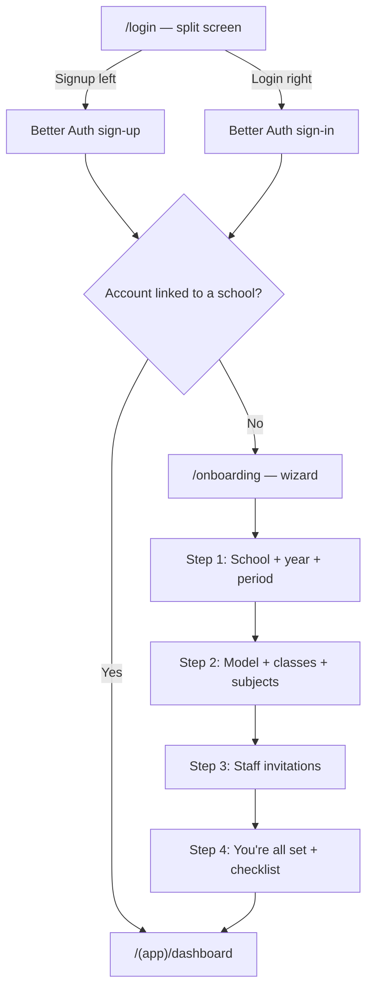

# School Onboarding — Sprint Plan

> **Status:** In progress (Phases 0–7 implemented; **next: Phase 8**)  
> **Created:** 2026-06-28  
> **Scope:** Public registration, split login/signup auth screen, school setup wizard (replaces manual seeding for new accounts)  
> **Depends on:** Better Auth (done), `POST /core/onboarding/register-school` (done), staff invitations (Phase 5 webapp — in progress), `@edaya/dev-fixtures` (middle school / high school templates)  
> **Related docs:** [`specs/design-language-spec.md`](../specs/design-language-spec.md), [`docs/local-dev.md`](../docs/local-dev.md), [`sprints/done/account-invitation-plan.md`](./done/account-invitation-plan.md)

---

## Progress tracker

Check off when the phase (or sub-phase) is complete and merged.

- [x] **Phase 0** — Auth email delivery (OTP / verification) — *validated 2026-06-28 (Novu US + real email)*
- [x] **Phase 1** — Split auth screen (login on the right · signup on the left)
- [x] **Phase 2** — Registration + unlinked account redirect
- [x] **Phase 3** — Wizard shell + progress bar
- [x] **Phase 4** — Step 1: school identity + year / period
- [x] **Phase 5** — Step 2: school model + classes + curriculum
- [x] **Phase 6** — Step 3: staff invitations
- [x] **Phase 7** — Step 4: wizard exit + checklist
- [ ] **Phase 8** — Dev cutover (optional seeding vs wizard)
- [ ] **Phase 9** — Grade-level curriculum templates (subjects + chapters per grade)

---

## 1. Problem and goal

### Current situation

| Flow | Behavior |
|------|----------|
| **Login** | `/login` — sign-in only; demo accounts via fixtures |
| **Dev seeding** | `bun seed:init` creates Better Auth users + school via fixtures + loads ~all demo entities |
| **New real account** | Split signup UI + Novu email (verification); OTP login; redirect to `/onboarding` if unlinked |
| **Empty school** | `register-school` API exists; `/core/*` session returns 401 until the account is linked to an actor |

### Product goal

1. **Redesigned login page** — split layout inspired by the provided mockup, adapted to the EDAYA design system (institutional teal, not generic blue):
   - **Left**: "Create an account" panel (name, email, password, confirmation)
   - **Right**: current login (`LoginPanelHost` — password + email OTP)
   - Cross-links: "Already have an account?" / "Don't have an account yet?"

2. **Post-registration wizard** — 4-step wizard with progress bar to configure a school **without** `bun seed:init`.

3. **Personal cutover** — you can `rm -rf .data`, create your account with a **real email**, receive the email, and populate the school via the wizard.

### Non-goals (v1)

- OAuth / Google / Facebook (as in the mockup — out of scope)
- Multi-school per account (1 account = 1 school in v1)
- CSV student import in the wizard (manual step 4)
- Demo population (students, grades, absences) — remains in `bun seed` for demos

---

## 2. Target user journey



---

## 3. Existing foundation (reuse)

| Capability | Location | Notes |
|------------|----------|-------|
| Email/password sign-up | Better Auth + `/invite/[token]` | Signup pattern already proven |
| Email OTP | `emailOTP` plugin + `LoginEmailOtpPanel` | Dev mailer = console log only |
| Register school + owner | `registerSchoolWithOwner` | Feature flag `ALLOW_PUBLIC_SCHOOL_REGISTRATION` |
| Unlinked session | `bootstrapSession` → 401 → `session: null` | Hook for onboarding redirect |
| School structure | `SetupServiceWorkflow` | `createAcademicYear`, `createAcademicPeriod`, `createClassGroup`, `registerStaffMember` |
| FR grade-level templates | `SEED_GRADE_LEVELS` in `@edaya/dev-fixtures` | 6e → Terminale, middle school / high school cycles |
| Curriculum seed | `CurriculumSeedPort` | Subjects, chapters, class subjects |
| Invitations | `AccountInvitationServiceWorkflow` + Novu | Staff email via `account_invitation` workflow |

---

## 4. UI architecture

### 4.1 Split auth layout (`AuthSplitShell`)

Replace the single centered layout of `AuthScreenShell` with a **two-column** shell on `md+`; stacked on mobile (signup on top, login below).

```
┌─────────────────────────────┬─────────────────────────────┐
│  Left panel (primary)       │  Right panel (card)         │
│  ─────────────────────      │  ─────────────────────      │
│  Headline title             │  EDAYA logo + "Sign in"     │
│  Product value copy         │  LoginMethodPicker          │
│  [Create my account] CTA    │  LoginPasswordPanel / OTP   │
│  ─ or signup form ─         │  Link → switch panel        │
│  Name · Email · Pwd · Conf. │                             │
│  [Sign up]                  │                             │
└─────────────────────────────┴─────────────────────────────┘
```

**Design (design-language-spec):**

- Left panel: `bg-primary text-primary-foreground`, typography `font-display`, CTA `rounded-full` or `rounded-xl`
- Right panel: `bg-background`, existing login card (`rounded-2xl border shadow-soft`)
- No generic blue — EDAYA teal (`--primary`)

**Key files:**

- `apps/webapp/src/lib/components/auth/AuthSplitShell.svelte` (new)
- `apps/webapp/src/lib/components/auth/signup/SignupPanel.svelte` (new)
- `apps/webapp/src/routes/login/+page.svelte` — migrate to split shell

### 4.2 Wizard layout (`OnboardingShell`)

Outside app shell (no sidebar). Minimal header: EDAYA logo + `LanguageSelector` + signed-in email + sign out.

- **Stepper** horizontal: 4 steps, state `completed | active | upcoming`
- Body: full-width form (`max-w-2xl` centered)
- Sticky footer: `Previous` · `Skip` (if optional) · `Continue`

Route: `apps/webapp/src/routes/onboarding/+layout.svelte` + sub-routes or query `?step=1..4`.

---

## 5. Detailed phases

---

### Phase 0 — Auth email delivery

**Estimated effort:** 4–8 h  
**Suggested PR:** `feature/auth-email-delivery`  
**Blocks:** registration with a real email

**Problem:** `createAuthOtpMailer` logs the OTP in dev and warns in production — no real email is sent.

#### 0.1 Wire auth mailer to Novu (or SMTP)

- [x] Create `AuthEmailDeliveryPort` in `@edaya/adaptor-novu` (`auth-email-delivery.ts`)
- [x] Implement sending via Novu workflows `auth.otp` + `auth.email_verification`
- [x] Dev fallback without Novu: keep console log
- [x] Document in `docs/local-dev.md`: required variables to receive a real OTP

#### 0.2 Signup email verification (if password)

- [x] Enable Better Auth `emailVerification` when Novu is configured
- [x] Verification email via the same Novu channel
- [x] UI: "Check your inbox" state after signup (Phase 1 — `SignupPanel`)

#### 0.3 Manual test (done criteria)

- [x] Sign up with a personal email address → receive the email (OTP or verification link)
- [x] Sign in with that account → Better Auth session OK, `/core/*` still 401 (unlinked)

**Validated local config:** `NOVU_SECRET_KEY` + `NOVU_API_URL=https://api.novu.co` in `apps/api/.dev.vars`; `bun novu:bootstrap:apply` (workflows `auth.otp`, `auth.email_verification`).

**Key files:** `apps/api/src/runtime/shared/adapters/auth-otp-mailer.ts`, `better-auth.ts`, `package/adaptor-novu/src/auth-email-delivery.ts`, Novu bootstrap scripts

---

### Phase 1 — Split auth screen

**Estimated effort:** 6–10 h  
**Suggested PR:** `feature/auth-split-login-signup`

#### 1.1 `AuthSplitShell`

- [x] Responsive two-column component (mockup → EDAYA design system)
- [x] Keep language header
- [x] Mobile: tabs "Sign in" / "Create an account"

#### 1.2 `SignupPanel`

- [x] Fields: full name, email, password, password confirmation
- [x] Client validation (email format, password ≥ 8 chars, confirmation match)
- [x] Call `authClient.signUp.email` (pattern from `/invite/[token]`)
- [x] Existing account handling → switch to right panel + pre-fill email
- [x] i18n FR/EN

#### 1.3 Login page integration

- [x] Refactor `login/+page.svelte`: signup on the left, `LoginPanelHost` unchanged on the right
- [x] Links "Already have an account? Sign in" / "Create an account"
- [x] Demo link footer kept if `isDemoLoginEnabled()`

**Done when:** split screen visible; signup creates a Better Auth user; right-side login still works.

---

### Phase 2 — Unlinked account redirect

**Estimated effort:** 3–5 h  
**Suggested PR:** `feature/onboarding-auth-redirect`

#### 2.1 Post-auth navigation guard

- [x] New helper `resolvePostAuthPath()`:
  - session `/core/authorization/effective-grants` OK → dashboard (principal) or business route
  - Better Auth OK but core 401 → `/onboarding`
- [x] Update `completeAuthSignIn`, `redirectPathIfLoggedIn`, signup success handler

#### 2.2 Onboarding route guard

- [x] `(app)` layout: if user signed in without actor → redirect `/onboarding`
- [x] `/onboarding`: if user already linked → redirect dashboard
- [x] Public onboarding route (outside `(app)` shell)

#### 2.3 Feature flag

- [x] Expose on webapp whether public registration is enabled (aligned with `ALLOW_PUBLIC_SCHOOL_REGISTRATION`)
- [x] Hide signup if disabled (prod without flag)

**Key files:** `complete-sign-in.ts`, `bootstrap.ts`, `routes/onboarding/+layout.ts`

---

### Phase 3 — Wizard shell + progress

**Estimated effort:** 4–6 h  
**Suggested PR:** `feature/onboarding-shell`

- [x] `OnboardingShell.svelte` + `OnboardingStepper.svelte`
- [x] Store or URL `step` (1–4) with validation before advancing
- [x] Local draft persistence (`sessionStorage`) — resume on refresh
- [ ] *(Optional v1.1)* API `GET/PATCH /core/onboarding/draft` for cross-device resume

**Done when:** navigation 1→4 with visual stepper; draft data survives refresh.

---

### Phase 4 — Step 1: School identity

**Estimated effort:** 6–8 h  
**Suggested PR:** `feature/onboarding-step-school`

**Form:**

| Field | Detail |
|-------|--------|
| School name | required |
| City, country | required |
| Timezone | IANA select, browser default |
| Academic year | e.g. "2025–2026" + start/end dates |
| Active period | e.g. "Term 1" + dates; type `trimester` |

**API actions (end of step):**

1. `POST /core/onboarding/register-school` — creates school + owner staff + links `subjectId`
2. `createAcademicYear` — core command
3. `createAcademicPeriod` + `publishAcademicPeriod`

- [x] Form UI + validation
- [x] Sequential mutations with error toast
- [x] After success: `bootstrapSession()` → active principal staff session
- [ ] Integration tests: register-school + year + period

**Note:** extend `register-school` payload if needed (owner name already supported).

---

### Phase 5 — Step 2: Model + classes + curriculum

**Estimated effort:** 12–16 h  
**Suggested PR:** `feature/onboarding-step-structure`

**Core product — replaces the structure portion of seeding.**

#### 5.1 Onboarding templates package

Extract from `@edaya/dev-fixtures` into `package/onboarding-templates/` (or dedicated folder):

- [x] **Middle school** (6e–3e) and **High school** (2nde, 1ère, Terminale) models — API templates (`structure-templates.ts`)
- [x] Base subjects + placeholder chapters (`Subject` / `SubjectMatter`) — 6 identical subjects for all grades *(per-grade enrichment → Phase 9)*
- [x] Grade level → `GradeLevel` records mapping

#### 5.2 Model selection UI

- [x] Middle school / High school checkboxes (multi-select)
- [x] For each checked grade level:
  - number of classes (stepper 1–n)
  - max capacity per class (default 30)
  - preview generated names (`6e A`, `6e B`, …)
- [x] Summary before validation

#### 5.3 Batch structure API

Option A (recommended v1): **dedicated endpoint** orchestrated on the API side

- [x] `POST /core/onboarding/apply-structure-template`
- [x] Body: `{ models: ['college','lycee'], levels: [{ gradeLevelId, classCount, capacity }] }`
- [x] Server: creates `GradeLevel`, `ClassGroup`, `Subject`, `SubjectMatter`, `ClassSubject`, chapter links — in one transaction

Option B: chain existing commands from the client (more requests, more fragile).

- [x] Implement Option A
- [x] Tests: 2 classes 6e + 1 5e → expected entities in DB

#### 5.4 Key files

- `testing/dev-fixtures/src/dataset.ts` (template source)
- `package/domain-core/.../setup.ts`, curriculum workflows
- New onboarding route handler

---

### Phase 6 — Step 3: Staff invitations

**Estimated effort:** 6–8 h  
**Suggested PR:** `feature/onboarding-step-staff-invites`  
**Depends on:** Phase 5 webapp (invitations) + Novu email configured

**Repeatable form:**

| Field | Detail |
|-------|--------|
| Email | required |
| Profile / role | predefined select (Deputy principal, CPE, Teacher, Secretary, …) → permission mapping |

- [x] Add/remove rows (app-shell modal list pattern)
- [x] `registerStaffMember` + `sendAccountInvitation: true` per row
- [x] "Skip this step" button (0 invitations OK)
- [x] Reuse Novu `account_invitation` templates

**Done when:** invitations sent via real email; staff visible in School menu after onboarding complete.

---

### Phase 7 — Step 4: Exit + checklist

**Estimated effort:** 4–6 h  
**Suggested PR:** `feature/onboarding-completion`

- [x] Success screen: "Your school is ready"
- [x] Deep-link checklist (non-blocking):
  - Refine subjects / chapters → Configuration
  - Add students → School / Students
  - Timetables → Scheduling
  - Billing → Finance
- [x] Primary CTA → `/(app)/dashboard`
- [x] Mark onboarding complete (local flag + optional API `onboardingCompletedAt` on school)

---

### Phase 8 — Dev cutover (seeding vs wizard)

**Estimated effort:** 2–4 h  
**Suggested PR:** `chore/onboarding-dev-docs`

**Goal:** allow working **without** `bun seed:init` for your personal account.

- [ ] Document "fresh `.data` + onboarding" flow in `docs/local-dev.md`
- [ ] Keep `bun seed:init` for CI demo and seed integration tests
- [ ] `bootstrapHttpCoreSession` (seeding): no longer the default path for new devs — note in README
- [ ] Smoke script `bun seed:smoke`: accept onboarding account (not only fixtures)
- [ ] *(Optional)* `.env` flag `SKIP_DEMO_SEED=true` for `bun dev` without auto-waiting for seed

**Personal criteria (your test):**

```sh
# 1. Stop bun dev
rm -rf .data
bun dev
# 2. Open /login → signup on the left with your real email
# 3. Receive email → verify / OTP
# 4. Complete 4-step wizard
# 5. Land on dashboard with YOUR school (not sch-edaya-central)
```

---

### Phase 9 — Grade-level curriculum templates

**Estimated effort:** 8–12 h  
**Suggested PR:** `feature/onboarding-grade-curriculum-templates`  
**Depends on:** Phase 5 (batch structure)  
**Blocks:** nothing — can run in parallel with Phase 8

**Problem:** Phase 5 creates the same 6 subjects for all grades (6e = Terminale), with a single "Base curriculum" chapter. The logbook and subject configuration lack realism after the wizard.

**Goal:** differentiate subjects and chapters by `GradeLevelTemplateKey` (6e, 5e, … Terminale), without changing the wizard UI (step 2 unchanged).

#### 9.1 Template model

- [ ] `GradeLevelTemplateKey → SubjectTemplate[]` (references by `code`: `MATH`, `FR`, …)
- [ ] `SubjectTemplate → SubjectMatter[]` (ordered chapters, ≥ 2 per subject)
- [ ] School catalog **deduplicated by code** — one `Subject` entity per code, reused across grades
- [ ] Chapters (`SubjectMatter`): shared or grade-specific (e.g. "Numbers and calculation" in 6e, "Derivatives" in Terminale)
- [ ] Single source shared with `@edaya/dev-fixtures` (avoid seed / onboarding divergence)

#### 9.2 v1 content (generic EDAYA, not official French curriculum)

| Grade | Subjects |
|-------|----------|
| 6e – 3e (middle school) | 6 core: Maths, French, History-Geography, Sciences, English, PE |
| 2nde | middle school base + LV2 (optional v1) |
| 1ère / Terminale | high school base + Philosophy + Physics-Chemistry *(aligned with `extended-dataset`)* |

Out of scope v1: S / ES / L tracks, vocational options (AO), French Ministry of Education curriculum.

#### 9.3 API

- [ ] Extend `apps/api/src/lib/onboarding/structure-templates.ts` — per-grade templates
- [ ] Adapt `apply-structure-template.ts`:
  - create `Subject` catalog once (by code)
  - for each class: only offer subjects from its grade template
  - create corresponding `SubjectMatter` and `ClassSubjectMatter`
- [ ] Integration tests:
  - `6e A` ≠ `Terminale A` (number and types of subjects)
  - multiple chapters per subject, status `NotStarted`
  - no regression if only one grade configured

#### 9.4 Webapp

- [ ] No form changes for step 2 (transparent behavior)
- [ ] *(Optional)* summary preview: "X subjects · Y chapters per grade" before validation
- [ ] Phase 7 checklist: Configuration subjects link remains for manual refinement

#### 9.5 Key files

- `apps/api/src/lib/onboarding/structure-templates.ts`
- `apps/api/src/lib/onboarding/apply-structure-template.ts`
- `testing/dev-fixtures/src/dataset.ts`, `extended-dataset.ts` (source to unify)
- `apps/api/tests/routes/test-onboarding-apply-structure-route.test.ts`

**Done when:** after the wizard, a 6e and a Terminale logbook show **different** subjects; each subject has ≥ 2 usable chapters for progress tracking.

---

## 6. Product decisions to finalize

| # | Question | v1 recommendation |
|---|----------|-------------------|
| D1 | Signup: password or OTP only? | **Password** for owner (invite pattern); OTP remains for quick login |
| D2 | Email verification required before wizard? | **Yes** — prevents throwaway accounts |
| D3 | Step 3 staff required? | **No** — skippable |
| D4 | Curriculum templates | Generic EDAYA per grade (Phase 9); official French curriculum in v2 |
| D5 | "AO" / vocational tracks | Out of v1 |
| D6 | Batch structure endpoint vs client commands | **Batch endpoint** |

---

## 7. Effort / dependency matrix

```text
Phase 0 (email) ──► Phase 1 (split UI) ──► Phase 2 (redirect)
                                              │
                                              ▼
                                    Phase 3 (shell)
                                              │
                         ┌────────────────────┼────────────────────┐
                         ▼                    ▼                    ▼
                   Phase 4 (school)      Phase 5 (structure)   Phase 6 (staff)
                         │                    │                    │
                         └────────────────────┴────────────────────┘
                                              │
                                              ▼
                                    Phase 7 (completion)
                                              │
                              ┌───────────────┴───────────────┐
                              ▼                               ▼
                    Phase 8 (cutover docs)          Phase 9 (curriculum / grade)
                              │                               │
                              └──────── (parallel possible) ────┘
```

| Phase | Effort | PRs | Blocked by |
|-------|--------|-----|------------|
| 0 | 4–8 h | 1 | Novu SMTP configured |
| 1 | 6–10 h | 1 | — |
| 2 | 3–5 h | 1 | 1 |
| 3 | 4–6 h | 1 | 2 |
| 4 | 6–8 h | 1 | 3 |
| 5 | 12–16 h | 1–2 | 4 |
| 6 | 6–8 h | 1 | 5, Novu invite |
| 7 | 4–6 h | 1 | 6 |
| 8 | 2–4 h | 1 | 7 |
| 9 | 8–12 h | 1 | 5 |
| **Total** | **~55–83 h** | **10–11 PRs** | |

---

## 8. Tests

| Level | Coverage |
|-------|----------|
| **Unit** | Structure templates, per-grade curriculum templates, class name generation, form validation |
| **Integration** | `register-school` → year → period; batch structure; curriculum per grade; invitation send |
| **Manual E2E** | Real email signup → full wizard → dashboard |
| **Regression** | `bun seed:init` + demo login unchanged; existing seed tests green |

---

## 9. Ops checklist (before your real email test)

- [ ] Novu: `auth.otp` + `account_invitation` workflows active
- [ ] Novu: email integration (Cloudflare SMTP or other) configured
- [ ] `ALLOW_PUBLIC_SCHOOL_REGISTRATION=true` in `apps/api/.dev.vars`
- [ ] `WEBAPP_ORIGIN` / CORS aligned with your local port
- [ ] API restarted after Novu secret changes

---

## 10. Recommended next PR

**Phase 8** — dev cutover docs (optional seeding vs wizard).

Remaining order:

1. **Phase 8** — dev cutover docs (optional seeding)
2. **Phase 9** — per-grade curriculum templates (credible logbook; can run in parallel with Phase 8)

---

## Appendix — Seeding → wizard mapping

| Current HTTP seeding | Wizard step |
|----------------------|-------------|
| `bootstrapHttpCoreSession` → `register-school` | Step 1 |
| `school-structure`: grade levels, classes, year, period | Step 1 + 2 |
| `curriculum`: subjects, matters, class subjects | Step 2 (Phase 5); per grade (Phase 9) |
| `auth-link`: link fixture users | Real signup (no longer needed) |
| `population`: students, guardians | Out of scope — manual configuration |
| `assessments`, `attendance`, … | Demo only — `bun seed` |
