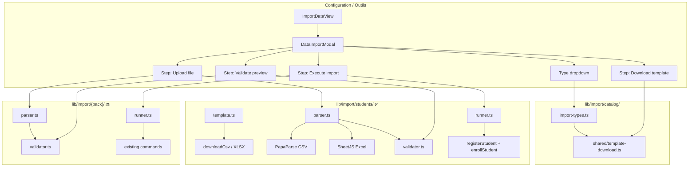

# Data Import — Client-Side Implementation Plan

> **Status:** Students ✅ · Classes ✅ · Guardians ✅ · Staff ✅ · Teachers ✅ · Subjects ✅ · Chapters ✅  
> **Created:** 2026-07-11  
> **Updated:** 2026-07-18 (breakdown phases 15–20 — evolution track)  
> **Scope:** Frontend only — no new backend endpoints  
> **Location:** Configuration → **Outils** (`/configuration/import`)  
> **Active packs:** Students, Guardians, Staff, Teachers, Classes, Subjects, Chapters, **Payments** (`.csv` + `.xlsx`)  
> **Template-only packs:** —

---

## Goal

Allow school admins to bulk-import school data from spreadsheets without backend changes. The browser:

1. Offers downloadable templates per data type (CSV + Excel)
2. Accepts filled `.csv` or `.xlsx` files
3. Parses and validates rows locally
4. Creates entities via **existing API commands** (one pack at a time)

**Recommended import order:** Classes → Élèves → Tuteurs → (Personnel / Enseignants) → Matières → Chapitres

---


## Current state (2026-07-12)


| Area                                                              | Status              |
| ----------------------------------------------------------------- | ------------------- |
| Nav + route `/configuration/import`                               | ✅                   |
| Page **Outils** with single generic import card                   | ✅                   |
| `DataImportModal` — 4-step wizard + type dropdown                 | ✅                   |
| Import type catalog (8 types, ordered)                            | ✅                   |
| Generic CSV/Excel template download                               | ✅                   |
| **Students** — parse / validate / run (+ matricule persist)       | ✅                   |
| **Classes** — parse / validate / run                              | ✅                   |
| **Guardians** — parse / validate / run (+ `eleve_matricule` link) | ✅                   |
| **Staff** — parse / validate / run                                | ✅                   |
| **Teachers** — parse / validate / run (+ `subjectId` hint)        | ✅                   |
| **Subjects** — parse / validate / run (**par niveau** — Phase 19) | ✅                   |
| **Chapters** — parse / validate / run (`niveau` + `matiere`)      | ✅                   |
| **Payments** — parse / validate / run (`recordPayment`)           | ✅                   |
| **Evolution 15–20** — règles métier + catalogue UI                | ⏳ Phase 20 + polish |
| Unit tests (`tests/lib/import/*`)                                 | ✅ 90 tests          |
| `eslint --fix` + `lint` + `check` (phases 8–14)                   | ⏳ fin de track      |


---


## Remaining work


### Vérification — pendant les phases vs fin de track

> **Pendant les phases 8–14 (implémentation) :** ne pas lancer `eslint --fix`, `bun run lint` ni `bun run check` après chaque sous-tâche ni après chaque phase.  
> Lancer uniquement les **tests unitaires du pack** concerné :
>
> ```bash
> cd edaya_web/apps/webapp
> bun test tests/lib/import/{pack}/
> ```
>
> **Quand toutes les phases sont cochées** (8 → 14 + polish), **une seule passe globale** avant merge / handoff :
>
> ```bash
> cd edaya_web
> bun test tests/lib/import/
> cd apps/webapp && bun run lint -- --fix
> cd ../.. && bun run lint && bun run check
> ```


| Phase / PR                                          | Tests unitaires                                                                              | `eslint --fix` + `lint` + `check` | Date       |
| --------------------------------------------------- | -------------------------------------------------------------------------------------------- | --------------------------------- | ---------- |
| Phases 0–7 (students + shell)                       | `tests/lib/import/students/`                                                                 | ✅ (fait avant politique)          | 2026-07-11 |
| PR5 — Phase 8 (classes)                             | `tests/lib/import/classes/`                                                                  | — (reporté fin de track)          | 2026-07-11 |
| PR6 — Phase 9 (guardians)                           | `tests/lib/import/guardians/`                                                                | — (reporté fin de track)          | 2026-07-12 |
| PR7 — Phase 10 (staff)                              | `tests/lib/import/staff/`                                                                    | — (reporté fin de track)          | 2026-07-12 |
| PR8 — Phase 11 (teachers)                           | `tests/lib/import/teachers/` (+ `tests/lib/teachers/pick-class-subject-for-teacher.test.ts`) | — (reporté fin de track)          | 2026-07-12 |
| PR9 — Phase 12 (subjects)                           | `tests/lib/import/subjects/`                                                                 | — (reporté fin de track)          | 2026-07-13 |
| PR10 — Phase 13 (chapters)                          | `tests/lib/import/chapters/`                                                                 | — (reporté fin de track)          | 2026-07-13 |
| PR11 — Phase 14 (polish)                            | tous les packs import                                                                        | —                                 |            |
| PR12 — Phase 19 (subjects/niveau)                   | `tests/lib/import/subjects/` · `chapters/`                                                   | —                                 | 2026-07-18 |
| PR13 — Phases 16–18 (students, guardians, teachers) | `tests/lib/import/students/` · `guardians/` · `teachers/`                                    | —                                 | 2026-07-18 |
| PR14 — Phase 15 (payments)                          | `tests/lib/import/payments/`                                                                 | —                                 | 2026-07-20 |
| PR15 — Phase 20 (catalogue UI)                      | —                                                                                            | —                                 |            |
| **Fin evolution (phases 15–20 ✅)**                  | `tests/lib/import/`                                                                          | [ ]                               |            |
| **Fin de track (phases 8–14 ✅)**                    | `tests/lib/import/`                                                                          | [ ]                               |            |


### Docs & QA

- [ ] T2 — Upload valid `.csv` (5 rows)
- [ ] T7 — Empty file parse error
- [ ] T10 — No classes prerequisite in modal
- [ ] G1 — Open modal from generic card
- [ ] G2 — Switch type in dropdown (columns + hint update)
- [x] G3 — Download template for each of 7 types
- [x] G4 — Non-active type shows coming-soon + Next disabled
- [ ] G5 — Students 4-step flow unchanged
- [ ] Update `remaining-work-plan.md` (Phase 6.4)


### Phase 8 — Classes import

- [x] 8.1 — `lib/import/classes/` parser + validator
- [x] 8.2 — Resolve `niveau` → `gradeLevelId`
- [x] 8.3 — Runner (`createClassGroupMutation` pattern)
- [x] 8.4 — Wire modal steps; `status: 'active'`
- [x] 8.5 — Unit tests


### Phase 9 — Guardians import

- [x] 9.1 — `lib/import/guardians/` parser + validator
- [x] 9.2 — Resolve `eleve_matricule` → `studentId`
- [x] 9.3 — Runner: register + link per row
- [x] 9.4 — `sendAccountInvitation: false` on bulk import
- [x] 9.5 — Wire modal; unit tests


### Phase 10 — Staff import

- [x] 10.1 — `lib/import/staff/` parser + validator
- [x] 10.2 — Runner (`registerStaffMember`, no invitation)
- [x] 10.3 — Role column: required + warning if unknown (assignment deferred)
- [x] 10.4 — Wire modal; unit tests


### Phase 11 — Teachers import

- [x] 11.1 — `lib/import/teachers/` parser + validator
- [x] 11.2 — Runner (`saveTeacher`, no invitation)
- [x] 11.3 — `matieres` → catalogue : warning si inconnu ; première matière → `teachers.save.subjectId`
- [x] 11.4 — Wire modal; unit tests (14 tests pack teachers)
- [x] 11.5 — Préremplissage affectation manuelle : `TeacherAssignmentFormModal` sélectionne la matière de classe via `teacher.subjectId`
- [x] 11.6 — Affectation auto complète (`teacherAssignments.save` + colonne `classe`) — voir 18.3


### Phase 12 — Subjects import

- [x] 12.1 — Template shape : colonne `classe` requise (une matière par classe)
- [x] 12.2 — `lib/import/subjects/` parser + validator
- [x] 12.3 — Runner (`subjects.save` + `addCustomClassSubject`)
- [x] 12.4 — Wire modal; unit tests (8 tests pack subjects)


### Phase 13 — Chapters import

- [x] 13.1 — `lib/import/chapters/` parser + validator
- [x] 13.2 — Resolve `matiere` → all matching class subjects (fan-out)
- [x] 13.3 — Runner (`configureSubjectMatter` via `saveChapterForClassSubject`)
- [x] 13.4 — Wire modal; unit tests (8 tests pack chapters)


### Phase 14 — Cross-pack polish

- [ ] 14.1 — Extract shared wizard logic from `DataImportModal` (optional)
- [ ] 14.2 — Per-type permission gates in modal
- [x] 14.3 — Per-type "Voir les …" links on result step (students, classes, guardians, staff, teachers)
- [x] 14.4 — Shared `canImportValidatedRows` helper (`validRows.length > 0`, errors excluded)
- [ ] 14.5 — E2E: modal, type switch, download each template


### Phase 15 — Paiements batch

- [x] 15.1 — `lib/import/payments/` types + parser + validator
- [x] 15.2 — Context loader : matricules, catalogue frais, `studentFees` (`loadPaymentImportContext`)
- [x] 15.3 — Runner : matricule + type_frais → `studentFeeId` → `recordPayment` (montant = solde restant)
- [x] 15.4 — Catalogue type `payments` + wire modal (upload / validate / execute)
- [x] 15.5 — i18n FR/EN + permission finance
- [x] 15.6 — Unit tests (`tests/lib/import/payments/`)


### Phase 16 — Révision import Élèves

- [x] 16.1 — Template : `matricule` obligatoire, `classe` facultative (ordre colonnes)
- [x] 16.2 — Validator : matricule requis ; normalisation `trim` + casse insensible
- [x] 16.3 — Runner : `registerStudent` ; `enrollStudent` seulement si classe résolue
- [x] 16.4 — Rejet matricule existant (fichier ou base) — message « élève existe déjà »
- [x] 16.5 — Warnings capacité : effectif + lignes fichier ; 1 warning / place manquante
- [x] 16.6 — Rafraîchir shell classes avant validation (éviter contexte stale)
- [x] 16.7 — Tests validator/runner mis à jour


### Phase 17 — Révision import Tuteurs

- [x] 17.1 — Parser multi-matricules : séparateur `;` sur `eleve_matricule`
- [x] 17.2 — Validator : succès partiel (warnings matricules invalides, liens valides OK)
- [x] 17.3 — Runner : 1 tuteur + N liens `linkGuardianToStudent` ; tests mis à jour


### Phase 18 — Enseignants : matières multiples

- [x] 18.1 — Import : `matieres` avec séparateur `;` (`matiere1;matiere2`)
- [x] 18.2 — UI : bouton **« Ajouter une matière »** (`TeacherAssignmentFormModal` lib + route)
- [x] 18.3 — Affectation auto import : colonne `classe` + `teacherAssignments.save` par matière
- [x] 18.4 — Tests parse/validate (`parseTeacherSubjectNames` avec `;`)


### Phase 19 — Matières par niveau (refonte)

- [x] 19.1 — Template : colonne `niveau` (remplace `classe`) + catalogue import
- [x] 19.2 — Validator : résolution `niveau` → `gradeLevelId` ; classes du niveau requises
- [x] 19.3 — Runner : `subjects.save` + `offerSubjectToGradeLevel` (`create-subject-for-grade-level.ts`)
- [ ] 19.4 — Sync chapitres catalogue : `assignMatterToGradeLevelSubject` (hors import batch)
- [x] 19.5 — Import chapitres révisé : colonnes `niveau` **+** `matiere`
- [x] 19.6 — Tests subjects/chapters mis à jour


### Phase 20 — Catalogue matières & UI leçons

- [ ] 20.1 — Uniformiser UI **Configuration → Catalogue des matières** (specs autres écrans)
- [ ] 20.2 — Bouton **« Ajouter une matière »** au catalogue (par niveau)
- [ ] 20.3 — Bouton **« Ajouter un chapitre »** au catalogue → sync classes du niveau
- [ ] 20.4 — Vue **Classes → Leçons** : miroir chapitres catalogue (pas cahier de suivi seul)
- [ ] 20.5 — Retirer toute affectation prof du panneau catalogue (config pure)

---


## Décisions produit (Phase 15+) — verrouillées 2026-07-18


| #       | Sujet                   | Décision                                                                                                                                                                                                                                                                                                                                                                                                                                  |
| ------- | ----------------------- | ----------------------------------------------------------------------------------------------------------------------------------------------------------------------------------------------------------------------------------------------------------------------------------------------------------------------------------------------------------------------------------------------------------------------------------------- |
| **C2**  | **Élève sans classe**   | **A** — `registerStudent` **sans** `enrollStudent` si `classe` vide.                                                                                                                                                                                                                                                                                                                                                                      |
| **C1**  | **Paiements batch**     | Type `payments` dans **Configuration → Outils** (`DataImportModal`). API `recordPayment` (équivalent batch de `PaymentFormModal`). **Obligatoires :** `matricule`, `type_frais`, `reference`. **Montant :** prérempli depuis le frais élève (solde restant ou montant catalogue — aligné modal). **Optionnel :** date, mode, notes, montant custom. Résolution : matricule → élève → `studentFeeId` (élève + type de frais déjà facturé). |
| **C3**  | **Matricule élève**     | Obligatoire **toutes lignes**. Normalisation : `trim()` + comparaison **insensible à la casse**.                                                                                                                                                                                                                                                                                                                                          |
| **C4**  | **Conflit matricule**   | Matricule déjà en base → **ligne rejetée** avec message « élève existe déjà » (pas de mise à jour). Doublon dans le fichier → idem bloquant.                                                                                                                                                                                                                                                                                              |
| **C5**  | **Capacité classe**     | **Warning** seulement (pas blocage). Calcul : effectif actuel + lignes valides du fichier par classe. Dépassement = **1 warning par place manquante** (ex. cap 25 + 30 lignes → **5 warnings**).                                                                                                                                                                                                                                          |
| **C6**  | **Tuteurs**             | Séparateur `;`. **Succès partiel :** tuteur créé + liens pour matricules valides ; **échec explicite** sur chaque matricule invalide (ligne partiellement importée).                                                                                                                                                                                                                                                                      |
| **C7**  | **Enseignants**         | **UI :** bouton « Ajouter une matière » à droite du select matière (`TeacherAssignmentFormModal`). **Import :** `matiere1;matiere2` + colonne `classe`.                                                                                                                                                                                                                                                                                   |
| **C8**  | **Matières par niveau** | Import : colonne `niveau`, plus `classe`. API : `offerSubjectToGradeLevel` (+ sync auto classes du niveau).                                                                                                                                                                                                                                                                                                                               |
| **C9**  | **Catalogue ↔ Leçons**  | Chapitres Leçons = miroir du catalogue. Ajout chapitre au catalogue → sync auto vers classes du niveau.                                                                                                                                                                                                                                                                                                                                   |
| **C10** | **Catalogue UI**        | Config pure (pas d’affectation prof). Bouton « Ajouter une matière » à ajouter. UI à uniformiser.                                                                                                                                                                                                                                                                                                                                         |
| **C11** | **Import chapitres**    | **Reste valide** en batch (complément du catalogue UI). Après Phase 19 : colonnes `niveau` **+** `matiere`.                                                                                                                                                                                                                                                                                                                               |


---


## Evolution track — Phase 15+ (résumé)

> **Détail complet :** checklists ([Remaining work](#remaining-work)) + sections détaillées ci-dessous ([Phase 15](#phase-15--paiements-batch-est-2--3-j) → [Phase 20](#phase-20--catalogue-matières--ui-leçons-est-2--3-j)).  
> **Contexte :** refonte **matière = par niveau** ; classes en héritage / sync. Packs 12–13 legacy remplacés par Phase 19.


### Synthèse priorités (ordre d'implémentation)

```text
1. Phase 14 (fermer track import actuel : lint/check + QA)
2. Phase 19 (matières par niveau — débloque catalogue + chapitres)
3. Phase 16 (élèves : matricule / classe / capacité)
4. Phase 17–18 (tuteurs + enseignants ; séparateur ;)
5. Phase 20 (UI catalogue)
6. Phase 15 (paiements batch — Outils)
```

**Statut 2026-07-20 :** phases 15–19 largement implémentées en code ; reste 19.4, Phase 20 complète.

**Remaining estimate (ouvert) :** ~3–4 j (Phase 20 + polish + tests payments)

---


### Upcoming PRs

- [x] PR5 — Phase 8 — Classes import
- [x] PR6 — Phase 9 — Guardians import
- [x] PR7 — Phase 10 — Staff import
- [x] PR8 — Phase 11 — Teachers import
- [x] PR9 — Phase 12 — Subjects import
- [x] PR10 — Phase 13 — Chapters import
- [ ] PR11 — Phase 14 — polish + docs
- [x] PR12 — Phase 19 — matières par niveau + chapitres `niveau`
- [x] PR13 — Phases 16–18 — élèves, tuteurs, enseignants UI/import
- [ ] PR14 — Phase 15 — paiements (tests 15.6)
- [ ] PR15 — Phase 20 — catalogue matières UI

---


## Constraints


| Constraint      | Decision                                                               |
| --------------- | ---------------------------------------------------------------------- |
| Backend changes | **None** — reuse existing `client.commands.`* per entity               |
| UI location     | **Configuration → Outils**                                             |
| File formats    | `.csv` and `.xlsx`                                                     |
| Volume target   | 20–100 rows per batch (sequential API calls)                           |
| Idempotency     | Per-pack rules (e.g. skip duplicate matricule for students)            |
| Partial import  | Import valid rows even when other rows have blocking errors (students) |


---


## Architecture




### Reuse existing code


| Existing                                                           | Reuse for                             |
| ------------------------------------------------------------------ | ------------------------------------- |
| `lib/list/list-csv-export.ts` → `downloadCsv`                      | All template downloads                |
| `lib/import/shared/template-download.ts`                           | Generic CSV/XLSX from catalog         |
| `lib/import/catalog/import-types.ts`                               | Type definitions + column specs       |
| `register-and-enroll-student.ts`                                   | Student import runner                 |
| `lib/academic/context.svelte`                                      | Class / year / grade-level resolution |
| `ImportFileDropzone`, `ImportValidationTable`, `ImportProgressBar` | All packs (shared UI)                 |


---


## Import type catalog

Dropdown order (as implemented):


| #   | Key         | Label (FR)  | Status     | Template files                  | Permission              |
| --- | ----------- | ----------- | ---------- | ------------------------------- | ----------------------- |
| 1   | `students`  | Élèves      | **active** | `eleves-template.csv/xlsx`      | `STUDENT_CREATE`        |
| 2   | `guardians` | Tuteurs     | **active** | `tuteurs-template.csv/xlsx`     | `STUDENT_CREATE`        |
| 3   | `staff`     | Personnel   | **active** | `personnel-template.csv/xlsx`   | `STAFF_CREATE`          |
| 4   | `teachers`  | Enseignants | **active** | `enseignants-template.csv/xlsx` | `STAFF_CREATE`          |
| 5   | `classes`   | Classes     | **active** | `classes-template.csv/xlsx`     | `SCHOOL_STRUCTURE_READ` |
| 6   | `subjects`  | Matières    | **active** | `matieres-template.csv/xlsx`    | `SCHOOL_STRUCTURE_READ` |
| 7   | `chapters`  | Chapitres   | **active** | `chapitres-template.csv/xlsx`   | `SCHOOL_STRUCTURE_READ` |


To activate a pack: implement `lib/import/{pack}/` (parser, validator, runner), set `status: 'active'` in catalog, wire `DataImportModal` steps 2–4 for that type.

---


## File structure

```
edaya_web/apps/webapp/src/
  lib/import/
    catalog/
      types.ts                    # ImportTypeKey, ImportTypeDefinition
      import-types.ts             # IMPORT_TYPE_DEFINITIONS (7 types)
    shared/
      file-accept.ts
      normalize-header.ts
      template-download.ts        # generic CSV/XLSX from catalog
    students/                     # ✅ complete
    classes/                      # ✅ complete
    guardians/                    # ✅ complete
    staff/                        # ✅ complete
    teachers/                     # ✅ complete (subjectId hint; class assignment manual)
    subjects/                     # ✅ complete
    chapters/                     # ✅ active

  lib/components/school/configuration/
    ImportDataView.svelte         # single generic card → opens modal
    DataImportModal.svelte        # type dropdown + 4-step wizard
    ImportFileDropzone.svelte
    ImportValidationTable.svelte
    ImportProgressBar.svelte

  lib/students/
    register-and-enroll-student.ts

  lib/teachers/
    save-teacher.ts
    pick-class-subject-for-teacher.ts   # préremplissage affectation manuelle

  routes/(app)/configuration/import/+page.svelte

tests/lib/import/
  students/                       # ✅
  classes/                        # ✅
  guardians/                      # ✅
  staff/                          # ✅
  teachers/                       # ✅
  shared/                         # ✅
tests/lib/teachers/
  pick-class-subject-for-teacher.test.ts  # ✅ (prefill affectation)
```

---


## Completed phases — Students MVP (Phases 0–6) ✅


### Phase 0 — Scaffolding ✅


| ID  | Task                                                                | Status |
| --- | ------------------------------------------------------------------- | ------ |
| 0.1 | Dependencies (`papaparse`, `xlsx`)                                  | ✅      |
| 0.2 | Nav `config.import` → `/configuration/import`                       | ✅      |
| 0.3 | i18n keys (fr + en)                                                 | ✅      |
| 0.4 | Route + `ImportDataView`                                            | ✅      |
| 0.5 | Permission gate (`STUDENT_CREATE` + `SCHOOL_STRUCTURE_READ` on nav) | ✅      |


### Phase 1 — Template download ✅


| ID  | Task                                          | Status |
| --- | --------------------------------------------- | ------ |
| 1.1 | `STUDENT_IMPORT_COLUMNS`                      | ✅      |
| 1.2 | `downloadStudentImportTemplate()` CSV + Excel | ✅      |
| 1.3 | Download buttons in modal step 1              | ✅      |
| 1.4 | Column legend + class prerequisite hint       | ✅      |


### Phase 2 — File parsing ✅


| ID  | Task                                       | Status |
| --- | ------------------------------------------ | ------ |
| 2.1 | `normalizeHeader()`                        | ✅      |
| 2.2 | CSV parser (PapaParse)                     | ✅      |
| 2.3 | XLSX parser (SheetJS + Excel date serials) | ✅      |
| 2.4 | `parseStudentImportFile(file)`             | ✅      |
| 2.5 | `StudentImportRow` with `rowIndex`         | ✅      |
| 2.6 | `ImportFileDropzone`                       | ✅      |
| 2.7 | Parser unit tests                          | ✅      |


### Phase 3 — Validation ✅


| ID  | Task                                        | Status |
| --- | ------------------------------------------- | ------ |
| 3.1 | Required fields (`prenom`, `nom`, `classe`) | ✅      |
| 3.2 | Date `YYYY-MM-DD`                           | ✅      |
| 3.3 | Class resolution + suggestions              | ✅      |
| 3.4 | Duplicate matricule in file                 | ✅      |
| 3.5 | Duplicate matricule vs existing             | ✅      |
| 3.6 | `{ validRows, errors[], warnings[] }`       | ✅      |
| 3.7 | `ImportValidationTable`                     | ✅      |
| 3.8 | Validator unit tests                        | ✅      |


### Phase 4 — Import execution ✅


| ID  | Task                                       | Status |
| --- | ------------------------------------------ | ------ |
| 4.1 | `registerAndEnrollStudent()` for runner    | ✅      |
| 4.2 | Sequential loop with unique IDs            | ✅      |
| 4.3 | Per-row try/catch, partial success         | ✅      |
| 4.4 | `notifyStudentsListChanged()` after import | ✅      |
| 4.5 | `ImportProgressBar`                        | ✅      |
| 4.6 | Result summary step 4                      | ✅      |
| 4.7 | Link "Voir les élèves"                     | ✅      |
| 4.8 | Runner unit tests                          | ✅      |


### Phase 5 — Modal wizard UX ✅


| ID  | Task                                                | Status |
| --- | --------------------------------------------------- | ------ |
| 5.1 | 4 steps: download → upload → validate → execute     | ✅      |
| 5.2 | Step indicator                                      | ✅      |
| 5.3 | Import when `validRows.length > 0` (partial import) | ✅      |
| 5.4 | Prerequisite banner (classes) in modal              | ✅      |
| 5.5 | Reset state on close / type change                  | ✅      |
| 5.6 | `data-testid` hooks                                 | ✅      |


### Phase 6 — Tests & polish ✅


| ID  | Task                                   | Status                                          |
| --- | -------------------------------------- | ----------------------------------------------- |
| 6.1 | `bun test tests/lib/import/students/*` | ✅ (19 tests)                                    |
| 6.2 | Manual test matrix (students)          | 🟡 8/10 — see [Remaining work](#remaining-work) |
| 6.4 | Update `remaining-work-plan.md`        | [ ]                                             |


**Lint/check :** voir [Vérification](#vérification--pendant-les-phases-vs-fin-de-track) (fait pour 0–7 ; reporté en fin de track pour 8+).

---


## Phase 7 — Generic import shell ✅


| ID  | Task                                            | Files                                         | Status |
| --- | ----------------------------------------------- | --------------------------------------------- | ------ |
| 7.1 | `ImportTypeDefinition` + catalog                | `catalog/types.ts`, `catalog/import-types.ts` | ✅      |
| 7.2 | Generic `template-download.ts`                  | `shared/template-download.ts`                 | ✅      |
| 7.3 | Rename `StudentImportModal` → `DataImportModal` | `DataImportModal.svelte`                      | ✅      |
| 7.4 | Type dropdown in step 1 (ordered list)          | `DataImportModal.svelte`                      | ✅      |
| 7.5 | Dynamic columns + template per type             | modal + catalog                               | ✅      |
| 7.6 | Single generic card on `ImportDataView`         | `ImportDataView.svelte`                       | ✅      |
| 7.7 | Nav label **Outils** (was "Import de données")  | `fr.ts`, `en.ts`                              | ✅      |
| 7.8 | `comingSoon` UX for `template_only` types       | modal                                         | ✅      |
| 7.9 | Teachers type + dropdown order finalized        | `import-types.ts`, i18n                       | ✅      |


**Exit criteria:** One import entry point; all 7 types downloadable; students full flow unchanged. ✅

---


## Future phases — Per-pack implementation

Each pack follows the same pattern as students:

```
lib/import/{pack}/
  types.ts       # columns, row types, validation issues
  template.ts    # optional if custom; else catalog exampleRow
  parser.ts      # parse{Pack}ImportFile → rows
  validator.ts   # validate{Pack}ImportRows(context) → validRows + errors
  runner.ts      # run{Pack}Import → { created, failed[] }
```

Then in `DataImportModal.svelte`:

- Branch steps 2–4 on `selectedImportType === '{pack}'`
- Or extract pack-specific step content into `{Pack}ImportSteps.svelte`

**Fin de phase :** tests unitaires du pack seulement — voir [Vérification](#vérification--pendant-les-phases-vs-fin-de-track).

### Phase 8 — Classes import (est. 1.5 d)

**Prerequisite:** None (classes are often imported first).


| Column     | Required | Maps to                     | Notes                  |
| ---------- | -------- | --------------------------- | ---------------------- |
| `nom`      | yes      | `createClassGroup.name`     | e.g. `6ème A`          |
| `niveau`   | yes      | resolved → `gradeLevelId`   | match grade level name |
| `capacite` | no       | `createClassGroup.capacity` | integer                |


**API (existing):**

```ts
await client.commands.createClassGroup({
  id, schoolId, academicYearId, gradeLevelId,
  name, capacity?, attendanceMode: 'session', homeroomStaffId: null,
});
```


| ID  | Task                                                     | Status |
| --- | -------------------------------------------------------- | ------ |
| 8.1 | `lib/import/classes/` parser + validator                 | [x]    |
| 8.2 | Resolve `niveau` → `gradeLevelId` from `academicContext` | [x]    |
| 8.3 | Runner via `createClassGroupMutation` pattern            | [x]    |
| 8.4 | Wire modal steps; set `status: 'active'`                 | [x]    |
| 8.5 | Unit tests                                               | [x]    |


---


### Phase 9 — Guardians import (est. 2 d)

**Prerequisite:** Students must exist (link by matricule).


| Column            | Required | Maps to                      | Notes                        |
| ----------------- | -------- | ---------------------------- | ---------------------------- |
| `prenom`          | yes      | `registerGuardian.firstName` |                              |
| `nom`             | yes      | `registerGuardian.lastName`  |                              |
| `email`           | no       | `registerGuardian.email`     |                              |
| `telephone`       | no       | `registerGuardian.phone`     |                              |
| `eleve_matricule` | yes      | resolved → `studentId`       | then `linkGuardianToStudent` |


**API (existing):**

```ts
await client.commands.registerGuardian({ id, schoolId, firstName, lastName, email, phone, ... });
await client.commands.linkGuardianToStudent({ guardianId, studentId, ... });
```


| ID  | Task                                                               | Status |
| --- | ------------------------------------------------------------------ | ------ |
| 9.1 | `lib/import/guardians/` parser + validator                         | [x]    |
| 9.2 | Resolve `eleve_matricule` → `studentId` (load existing matricules) | [x]    |
| 9.3 | Runner: register + link per row                                    | [x]    |
| 9.4 | `sendAccountInvitation: false` on bulk import                      | [x]    |
| 9.5 | Wire modal; unit tests                                             | [x]    |


---


### Phase 10 — Staff import (est. 1.5 d)


| Column      | Required | Maps to                                  | Notes                        |
| ----------- | -------- | ---------------------------------------- | ---------------------------- |
| `prenom`    | yes      | `registerStaffMember.firstName`          |                              |
| `nom`       | yes      | `registerStaffMember.lastName`           |                              |
| `email`     | no       | `registerStaffMember.email`              |                              |
| `role`      | yes      | deferred → permission assignment phase 2 | validate role exists or warn |
| `telephone` | no       | profile update phase 2                   | not on register command      |


**API (existing):**

```ts
await client.commands.registerStaffMember({
  id, schoolId, firstName, lastName, email,
  accountKind: 'human', isActive: true, sendAccountInvitation: false,
});
// Phase 2: assignStaffPermission for role column
```


| ID   | Task                                             | Status |
| ---- | ------------------------------------------------ | ------ |
| 10.1 | `lib/import/staff/` parser + validator           | [x]    |
| 10.2 | Runner via `registerStaffMember` (no invitation) | [x]    |
| 10.3 | Role column: required + warning if unknown       | [x]    |
| 10.4 | Wire modal; unit tests                           | [x]    |


---


### Phase 11 — Teachers import (est. 2 d)


| Column      | Required | Maps to                                            | Notes                                           |
| ----------- | -------- | -------------------------------------------------- | ----------------------------------------------- |
| `prenom`    | yes      | `teachers.save.firstName`                          |                                                 |
| `nom`       | yes      | `teachers.save.lastName`                           |                                                 |
| `email`     | no       | `teachers.save.email`                              |                                                 |
| `matieres`  | no       | `teachers.save.subjectId` (1ère matière catalogue) | comma-separated ; affectation classe = manuelle |
| `telephone` | no       | `teachers.save.phone`                              |                                                 |


**API (existing):**

```ts
await client.entities.teachers.save({
  id, schoolId, firstName, lastName, email, phone, subjectId, isActive: true,
});
// subjectId = première matière reconnue dans `matieres` (hint pour affectation manuelle)
// TeacherAssignmentFormModal pré-sélectionne classSubjectId quand la classe est choisie
// Phase 2 (11.6): saveTeacherAssignment automatique si colonne `classe` ajoutée
```


| ID   | Task                                                               | Status |
| ---- | ------------------------------------------------------------------ | ------ |
| 11.1 | `lib/import/teachers/` parser + validator                          | [x]    |
| 11.2 | Runner via `saveTeacher` (no invitation)                           | [x]    |
| 11.3 | `matieres` → catalogue ; warning si inconnu ; `subjectId` persisté | [x]    |
| 11.4 | Wire modal; unit tests                                             | [x]    |
| 11.5 | Préremplissage affectation manuelle via `teacher.subjectId`        | [x]    |
| 11.6 | Affectation auto (`teacherAssignments.save` + `classe`)            | [x]    |


---

**Remaining estimate:** ~1 day (polish only)

### Phase 12 — Subjects import (est. 2 d)

> **⚠ Legacy (2026-07-13) :** implémenté **par classe** (`classe` + `addCustomClassSubject`).  
> **Cible Phase 19 :** matière **par niveau** + sync classes — voir [Phase 19](#phase-19--matières-par-niveau-refonte--est-3-j).

**Prerequisite:** Classes exist (subjects are per-class via `classSubject`).


| Column        | Required | Maps to                     | Notes            |
| ------------- | -------- | --------------------------- | ---------------- |
| `nom`         | yes      | `subjects.name`             |                  |
| `classe`      | yes      | resolved → `classGroupId`   | match class name |
| `code`        | no       | `subjects.code`             |                  |
| `coefficient` | no       | `classSubjects.coefficient` | positive number  |


**API (existing):**

```ts
await client.entities.subjects.save({ id, schoolId, name, code?, defaultCoefficient?, category, color });
await client.commands.addCustomClassSubject({ id, classGroupId, subjectId, coefficient?, isOffered: true });
// classSubjects.save and offerSubjectToClass are not available to school browser sessions
```


| ID   | Task                                      | Status |
| ---- | ----------------------------------------- | ------ |
| 12.1 | Template shape : `classe` column required | [x]    |
| 12.2 | `lib/import/subjects/` parser + validator | [x]    |
| 12.3 | Runner via `createSubjectForClass` helper | [x]    |
| 12.4 | Wire modal; unit tests                    | [x]    |


---


### Phase 13 — Chapters import (est. 2 d)

> **⚠ Legacy :** résolution `matiere` sans `niveau` (fan-out toutes classes). À réaligner après Phase 19.

**Prerequisite:** Subjects / class subjects exist.


| Column        | Required | Maps to                          | Notes              |
| ------------- | -------- | -------------------------------- | ------------------ |
| `matiere`     | yes      | resolved → `classSubjectId`      | match subject name |
| `titre`       | yes      | `saveSubjectMatterMutation.name` |                    |
| `ordre`       | no       | `sequenceOrder`                  | default 1          |
| `description` | no       | `description`                    |                    |


**API (existing):**

```ts
await client.commands.configureSubjectMatter({
  id, subjectId, name, description?, sequenceOrder, estimatedHours: null,
});
// One file row can fan out to every class offering the same subject name
```


| ID   | Task                                                      | Status |
| ---- | --------------------------------------------------------- | ------ |
| 13.1 | `lib/import/chapters/` parser + validator                 | [x]    |
| 13.2 | Resolve `matiere` → all class subjects with matching name | [x]    |
| 13.3 | Runner via `saveChapterForClassSubject`                   | [x]    |
| 13.4 | Wire modal; unit tests                                    | [x]    |


---


### Phase 14 — Cross-pack polish (est. 1 d)


| ID   | Task                                                          | Status |
| ---- | ------------------------------------------------------------- | ------ |
| 14.1 | Extract shared wizard logic from `DataImportModal` (optional) | [ ]    |
| 14.2 | Per-type permission gates in modal (not just nav)             | [ ]    |
| 14.3 | Per-type "Voir les …" links on result step                    | [x]    |
| 14.4 | Shared `canImportValidatedRows(validRows.length > 0)` helper  | [x]    |
| 14.5 | E2E test: open modal, switch types, download each template    | [ ]    |


**Lint/eslint/check :** une passe globale quand **toutes** les phases 8–14 sont cochées — voir [Vérification](#vérification--pendant-les-phases-vs-fin-de-track).

---


## Evolution track — phases 15–20 (détail)

**Fin de phase (evolution) :** tests unitaires du pack concerné — même politique que phases 8–14. Passe globale `lint` + `check` quand phases 15–20 + 14 sont terminées.

### Phase 15 — Paiements batch (est. 2–3 j)

**Prerequisite:** Élèves existants avec **matricule** ; frais déjà **assignés** à l'élève (`studentFee` pour le `type_frais`).


| Column       | Required | Maps to                             | Notes                                       |
| ------------ | -------- | ----------------------------------- | ------------------------------------------- |
| `matricule`  | yes      | resolved → `studentId`              | via index matricules                        |
| `type_frais` | yes      | resolved → `feeId` → `studentFeeId` | nom frais catalogue                         |
| `reference`  | yes      | `recordPayment.reference`           |                                             |
| `montant`    | no       | `recordPayment.amount`              | **défaut = solde restant** (`total − paid`) |
| `date`       | no       | `recordPayment.paymentDate`         | défaut : aujourd'hui (`AAAA-MM-JJ`)         |
| `mode`       | no       | `recordPayment.method`              | défaut : `cash`                             |
| `notes`      | no       | `recordPayment.notes`               |                                             |


**API (existing):**

```ts
await client.commands.recordPayment({
  id, studentFeeId, amount, paymentDate, method,
  reference, notes, createdAt, referenceDate,
});
// Prérequis : assignFeeToStudent déjà exécuté pour l'élève + type de frais
```


| ID   | Task                                                   | Status |
| ---- | ------------------------------------------------------ | ------ |
| 15.1 | `lib/import/payments/` types + parser + validator      | [x]    |
| 15.2 | `loadPaymentImportContext` (fees, billing, matricules) | [x]    |
| 15.3 | Runner via `recordPaymentMutation`                     | [x]    |
| 15.4 | Catalogue type `payments` ; wire modal 4 steps         | [x]    |
| 15.5 | i18n FR/EN ; permission finance                        | [x]    |
| 15.6 | Unit tests                                             | [ ]    |


---


### Phase 16 — Révision import Élèves (est. 1.5 j)

**Prerequisite:** Aucun strict (classe facultative). Classes requises seulement si inscription souhaitée.


| Column           | Required | Maps to                                 | Notes                                       |
| ---------------- | -------- | --------------------------------------- | ------------------------------------------- |
| `prenom`         | yes      | `registerStudent.firstName`             |                                             |
| `nom`            | yes      | `registerStudent.lastName`              |                                             |
| `matricule`      | yes      | `updateStudentProfile.matricule`        | **obligatoire** ; `trim` + casse insensible |
| `classe`         | no       | resolved → `enrollStudent.classGroupId` | si absent : élève créé **sans** inscription |
| `date_naissance` | no       | `registerStudent.birthDate`             | `AAAA-MM-JJ`                                |
| `genre`          | no       | —                                       | ignoré (hors scope)                         |


**Règles validation :**


| Règle                               | Comportement                                                                  |
| ----------------------------------- | ----------------------------------------------------------------------------- |
| Matricule doublon (fichier ou base) | **Erreur bloquante** — « élève existe déjà »                                  |
| Capacité classe                     | **Warning** — 1 par place manquante (effectif + lignes fichier vs `capacity`) |


**API (existing):**

```ts
await client.commands.registerStudent({ ... });
if (classGroupId) {
  await client.commands.enrollStudent({ studentId, classGroupId, ... });
}
await client.commands.updateStudentProfile({ studentId, matricule, ... });
```


| ID   | Task                                              | Status |
| ---- | ------------------------------------------------- | ------ |
| 16.1 | Template + ordre colonnes (`matricule` requis)    | [x]    |
| 16.2 | Validator : matricule requis ; classe optionnelle | [x]    |
| 16.3 | Runner : inscription conditionnelle               | [x]    |
| 16.4 | Rejet matricule existant                          | [x]    |
| 16.5 | Warnings capacité (N warnings si dépassement)     | [x]    |
| 16.6 | Rafraîchir shell classes avant validation         | [x]    |
| 16.7 | Unit tests mis à jour                             | [x]    |


---


### Phase 17 — Révision import Tuteurs (est. 1 j)

**Prerequisite:** Élèves existants avec matricules enregistrés.


| Column            | Required | Maps to                      | Notes                              |
| ----------------- | -------- | ---------------------------- | ---------------------------------- |
| `prenom`          | yes      | `registerGuardian.firstName` |                                    |
| `nom`             | yes      | `registerGuardian.lastName`  |                                    |
| `eleve_matricule` | yes      | resolved → `studentId`(s)    | **multi-valeurs** séparées par `;` |
| `email`           | no       | `registerGuardian.email`     |                                    |
| `telephone`       | no       | `registerGuardian.phone`     |                                    |


**Règles validation / run :**


| Règle                | Comportement                                                           |
| -------------------- | ---------------------------------------------------------------------- |
| Séparateur           | `;` (pas virgule)                                                      |
| Matricules invalides | **Warning** si ≥1 matricule valide ; **erreur** si aucun valide        |
| Run                  | 1 tuteur + N × `linkGuardianToStudent` (matricules valides uniquement) |


**API (existing):**

```ts
await client.commands.registerGuardian({ ... });
for (const studentId of studentIds) {
  await client.commands.linkGuardianToStudent({ guardianId, studentId, ... });
}
```


| ID   | Task                                           | Status |
| ---- | ---------------------------------------------- | ------ |
| 17.1 | Parser multi-matricules (`parseSemicolonList`) | [x]    |
| 17.2 | Validator succès partiel + runner N liens      | [x]    |
| 17.3 | Template hint `;` ; unit tests                 | [x]    |


---


### Phase 18 — Enseignants : matières multiples (est. 2 j)

**Prerequisite:** Catalogue matières / class subjects existants pour affectation manuelle.


| Column      | Required | Maps to                                   | Notes                          |
| ----------- | -------- | ----------------------------------------- | ------------------------------ |
| `prenom`    | yes      | `teachers.save.firstName`                 |                                |
| `nom`       | yes      | `teachers.save.lastName`                  |                                |
| `email`     | no       | `teachers.save.email`                     |                                |
| `matieres`  | no       | `teachers.save.subjectId` (1ère reconnue) | `matiere1;matiere2`            |
| `telephone` | no       | `teachers.save.phone`                     |                                |
| `classe`    | no       | `teacherAssignments` (18.3)               | affectation auto par matière |


**UI (manuel) :**

- `TeacherAssignmentFormModal` : bouton **« Ajouter une matière »** → N affectations `subject` pour la même classe

**API (existing):**

```ts
await client.entities.teachers.save({ ..., subjectId: primarySubjectId });
// 18.3 :
await client.entities.teacherAssignments.save({ classGroupId, classSubjectId, ... });
```


| ID   | Task                                                     | Status |
| ---- | -------------------------------------------------------- | ------ |
| 18.1 | Import : séparateur `;` sur `matieres`                   | [x]    |
| 18.2 | UI multi-matières (`TeacherAssignmentFormModal`)         | [x]    |
| 18.3 | Import : colonne `classe` + affectation auto par matière | [x]    |
| 18.4 | Unit tests parse/validate                                | [x]    |


---


### Phase 19 — Matières par niveau (refonte — est. 3 j)

> Remplace l'implémentation legacy Phase 12 (`classe` + `addCustomClassSubject`).

**Prerequisite:** Niveaux (`gradeLevels`) + au moins une classe par niveau cible.


| Column        | Required | Maps to                                | Notes          |
| ------------- | -------- | -------------------------------------- | -------------- |
| `nom`         | yes      | `subjects.name`                        |                |
| `niveau`      | yes      | resolved → `gradeLevelId`              | ex. « 6ème »   |
| `code`        | no       | `subjects.code`                        |                |
| `coefficient` | no       | `offerSubjectToGradeLevel.coefficient` | nombre positif |


**API (existing):**

```ts
await client.entities.subjects.save({ id, schoolId, name, code?, defaultCoefficient?, ... });
await client.commands.offerSubjectToGradeLevel({
  id, gradeLevelId, academicYearId, subjectId, coefficient?,
  classSubjectIdsByClassGroupId: { [classGroupId]: classSubjectId, ... },
});
// Sync auto vers toutes les classes du niveau (cf. grade-level-subject-sync tests)
```

**Impact chapitres (19.5) :**


| Column    | Required | Notes                                       |
| --------- | -------- | ------------------------------------------- |
| `niveau`  | yes      | filtre les class subjects du niveau         |
| `matiere` | yes      | + fan-out vers classes du niveau uniquement |


| ID   | Task                                                               | Status |
| ---- | ------------------------------------------------------------------ | ------ |
| 19.1 | Template + catalogue : colonne `niveau`                            | [x]    |
| 19.2 | Validator : `resolveImportGradeLevel` + classes du niveau          | [x]    |
| 19.3 | Runner : `createSubjectForGradeLevel` → `offerSubjectToGradeLevel` | [x]    |
| 19.4 | Catalogue UI : chapitres via `assignMatterToGradeLevelSubject`     | [ ]    |
| 19.5 | Import chapitres : colonnes `niveau` + `matiere`                   | [x]    |
| 19.6 | Unit tests subjects + chapters                                     | [x]    |


---


### Phase 20 — Catalogue matières & UI leçons (est. 2–3 j)

**Prerequisite:** Phase 19 (matières par niveau) — source de vérité côté catalogue.

**Objectifs :**


| Zone                                       | Cible                                                                   |
| ------------------------------------------ | ----------------------------------------------------------------------- |
| **Configuration → Catalogue des matières** | Config pure (pas d'affectation prof) ; boutons ajout matière + chapitre |
| **Classes → Leçons**                       | **Miroir** des chapitres configurés au catalogue                        |
| Sync                                       | Ajout chapitre au catalogue → propagation auto vers classes du niveau   |


| ID   | Task                                                            | Status |
| ---- | --------------------------------------------------------------- | ------ |
| 20.1 | Uniformiser UI catalogue (aligner autres écrans config)         | [ ]    |
| 20.2 | Bouton **« Ajouter une matière »** (par niveau)                 | [ ]    |
| 20.3 | Bouton **« Ajouter un chapitre »** + sync classes               | [ ]    |
| 20.4 | Vue Leçons : afficher chapitres synchronisés (pas logbook seul) | [ ]    |
| 20.5 | Retirer affectation prof du panneau catalogue                   | [ ]    |


**Lint/eslint/check (evolution) :** voir [Vérification](#vérification--pendant-les-phases-vs-fin-de-track) — PR14–PR15 + fin evolution.

---


## UI spec — Configuration → Outils


### Page: `/configuration/import`

```
┌─────────────────────────────────────────────────────────────┐
│ Outils                                                      │
│ Importez vos données en masse à partir de fichiers CSV      │
│ ou Excel.                                                   │
│                                                             │
│ Ordre recommandé : Classes → Élèves → Tuteurs              │
│                                                             │
│ ┌─────────────────────────────────────────────────────┐     │
│ │ ⬆ Import de données                                 │     │
│ │ Choisissez le type, téléchargez le modèle, puis     │     │
│ │ importez votre fichier.                             │     │
│ │ Formats : .csv, .xlsx                               │     │
│ │                              [Importer]             │     │
│ └─────────────────────────────────────────────────────┘     │
└─────────────────────────────────────────────────────────────┘
```


### Modal: Data import (4 steps)


| Step | Title       | Content                                                |
| ---- | ----------- | ------------------------------------------------------ |
| 1    | Télécharger | **Type dropdown** + template CSV/Excel + column legend |
| 2    | Déposer     | File dropzone (active packs only)                      |
| 3    | Vérifier    | Validation table                                       |
| 4    | Résultat    | Progress + summary + entity link                       |


**Dropdown order:** Élèves → Tuteurs → Personnel → Enseignants → Classes → Matières → Chapitres

---


## Students — CSV template spec (reference)

**Filename:** `eleves-template.csv`


| Column           | Required | Maps to                                 | Notes                                     |
| ---------------- | -------- | --------------------------------------- | ----------------------------------------- |
| `prenom`         | yes      | `registerStudent.firstName`             | trimmed                                   |
| `nom`            | yes      | `registerStudent.lastName`              | trimmed                                   |
| `classe`         | yes      | resolved → `enrollStudent.classGroupId` | match class display name                  |
| `date_naissance` | no       | `registerStudent.birthDate`             | `YYYY-MM-DD`                              |
| `genre`          | no       | deferred                                | not sent in MVP                           |
| `matricule`      | no       | `updateStudentProfile.matricule`        | after `registerStudent` + `enrollStudent` |


**API per row:**

```ts
await client.commands.registerStudent({
  id, schoolId, firstName, lastName, birthDate?,
  sendAccountInvitation: false, createdAt: now,
});
await client.commands.enrollStudent({
  id: enrollmentId, studentId, classGroupId, createdAt: now,
});
// when matricule is present in the row:
await client.commands.updateStudentProfile({
  studentId, firstName, lastName, birthDate?, matricule,
});
```

---


## Manual test matrix — Students

> **Dernière QA manuelle :** 2026-07-11 — branche `feature/import-data`, compte Aminata Koné (propriétaire).


| #   | Scenario                     | Expected                                     | Status | Result (observed)                    |
| --- | ---------------------------- | -------------------------------------------- | ------ | ------------------------------------ |
| T1  | Download template            | Valid CSV/Excel with 6 columns + example row | [x]    | Modèles CSV et Excel OK              |
| T2  | Upload valid `.csv` (5 rows) | 5 students created, enrolled                 | [ ]    | Non testé explicitement              |
| T3  | Upload valid `.xlsx`         | Students created and enrolled                | [x]    | 36 lignes → 36 créés ; liste 30 → 66 |
| T4  | Unknown class name           | Blocking error; partial import OK            | [x]    | Suggestions affichées                |
| T5  | Missing required fields      | Blocking error per column                    | [x]    | L18/L20/L22/L24/L30                  |
| T6  | Invalid date                 | Blocking error                               | [x]    | `2012-14-14` rejeté                  |
| T7  | Empty file                   | Parse error message                          | [ ]    | Non testé                            |
| T8  | Large file (~36 rows)        | Progress bar; reasonable time                | [x]    | OK en local                          |
| T9  | Duplicate `matricule`        | Dupes blocked; partial import                | [x]    | L2 OK, L3–L7 bloqués                 |
| T10 | No classes in school         | Prerequisite in modal step 1                 | [ ]    | Non testé                            |


### Manual test matrix — Generic shell (new)


| #   | Scenario                        | Expected                             | Status |
| --- | ------------------------------- | ------------------------------------ | ------ |
| G1  | Open modal from generic card    | Modal opens on step 1                | [ ]    |
| G2  | Switch type in dropdown         | Columns + hint update; wizard resets | [ ]    |
| G3  | Download template for each type | 7 distinct CSV/Excel files           | [ ]    |
| G4  | Non-active type                 | "Coming soon" + Next disabled        | [ ]    |
| G5  | Students flow unchanged         | Full 4-step import still works       | [ ]    |


---


## Risks & mitigations


| Risk                                 | Mitigation                                          |
| ------------------------------------ | --------------------------------------------------- |
| Slow for large files                 | Progress bar; ~100 row soft limit in UI             |
| Partial import (no transaction)      | Clear summary per pack                              |
| Cross-entity prerequisites           | Document order; validate in each pack's validator   |
| Subject/chapter resolution ambiguity | Exact match + suggestions (same pattern as classes) |
| `DataImportModal` complexity         | Extract per-pack step components in Phase 14        |
| XLSX bundle size                     | Code-split on config route                          |


---


## Out of scope (entire track)

- Backend `/core/import/*` bulk endpoints
- `updateStudentProfile` for genre post-create
- Excel export of error report
- Rollback / undo import
- Account invitations on bulk import
- Real-time duplicate detection across concurrent imports

---


## Suggested PR breakdown


### Done


| PR   | Content                                           | Status |
| ---- | ------------------------------------------------- | ------ |
| PR1  | Phases 0–1 — nav, page, student template          | ✅      |
| PR2  | Phases 2–3 — student parser + validator           | ✅      |
| PR3  | Phases 4–5 — student runner + modal               | ✅      |
| PR4  | Phase 7 — generic shell + catalog + teachers type | ✅      |
| PR4b | Phase 6 — lint/check (fin de phase 0–7)           | ✅      |


### Upcoming


| PR   | Content                                     | Est.  | Status        |
| ---- | ------------------------------------------- | ----- | ------------- |
| PR5  | Phase 8 — Classes import                    | 1.5 d | ✅             |
| PR6  | Phase 9 — Guardians import                  | 2 d   | ✅             |
| PR7  | Phase 10 — Staff import                     | 1.5 d | ✅             |
| PR8  | Phase 11 — Teachers import                  | 2 d   | ✅             |
| PR9  | Phase 12 — Subjects import                  | 2 d   | ✅             |
| PR10 | Phase 13 — Chapters import                  | 2 d   | ✅             |
| PR11 | Phase 14 — polish + docs                    | 0.5 d | [ ]           |
| PR12 | Phase 19 — matières/niveau + chapitres      | 3 d   | ✅             |
| PR13 | Phases 16–18 — élèves, tuteurs, enseignants | 2.5 d | ✅             |
| PR14 | Phase 15 — paiements batch                  | 2 d   | ⏳ (sans 15.6) |
| PR15 | Phase 20 — catalogue UI                     | 2–3 d | [ ]           |


### Progression track (phases 8–20)


| Phase | Pack / thème                                      | Statut                        |
| ----- | ------------------------------------------------- | ----------------------------- |
| 8     | Classes                                           | ✅                             |
| 9     | Guardians (Tuteurs)                               | ✅                             |
| 10    | Staff                                             | ✅                             |
| 11    | Teachers (+ `subjectId` hint)                     | ✅                             |
| 12    | Subjects (legacy par classe)                      | ✅ → refonte Phase 19          |
| 13    | Chapters (legacy fan-out)                         | ✅ → refonte Phase 19.5        |
| 14    | Polish + lint/check global                        | ⏳                             |
| 15    | Paiements batch                                   | ⏳ (code ✅ ; tests 15.6)       |
| 16    | Élèves révisés (matricule, classe opt., capacité) | ✅                             |
| 17    | Tuteurs multi-matricules `;`                      | ✅                             |
| 18    | Enseignants multi-matières                        | ✅                               |
| 19    | Matières par niveau                               | ⏳ (import ✅ ; 19.4 catalogue) |
| 20    | Catalogue matières & UI leçons                    | [ ]                           |


---


## Acceptance criteria


### Students MVP ✅

- [x] `/configuration/import` accessible (nav: **Outils**)
- [x] Generic card opens `DataImportModal`
- [x] Student template downloads as `.csv` and `.xlsx`
- [x] Upload accepts `.csv` and `.xlsx`
- [x] Row-level validation before import
- [x] Import via `registerStudent` + `enrollStudent`
- [x] Progress and result summary
- [x] Unit tests (import: **90** tests · `tests/lib/import/`*)
- [x] Lint/check vert en fin de phase 0–7 (phases 8+ : voir fin de track)
- [x] No backend changes


### Generic shell ✅

- [x] Type dropdown with **8** ordered types (incl. **Paiements**)
- [x] Template download for all types
- [x] `template_only` types show coming-soon UX
- [x] Single import card on page (no per-type cards)


### Full track (remaining)

- [x] Classes import active
- [x] Guardians import active (+ student link)
- [x] Staff import active
- [x] Teachers import active (+ `subjectId` hint ; affectation classe manuelle)
- [x] Subjects import active (par **niveau** — Phase 19)
- [x] Chapters import active (`niveau` + `matiere` — Phase 19.5)
- [ ] Manual QA matrix G1–G5 + per-pack matrices
- [ ] `eslint --fix` + `lint` + `check` globaux (fin track 8–14)
- [ ] `remaining-work-plan.md` updated


### Evolution track (phases 15–20)

- [x] Phase 19 — Matières par `niveau` (`offerSubjectToGradeLevel`)
- [x] Phase 19.5 — Chapitres import `niveau` **+** `matiere`
- [x] Phase 16 — Élèves : matricule obligatoire, classe facultative, warnings capacité
- [x] Phase 17 — Tuteurs : matricules multiples `;`, succès partiel
- [x] Phase 18.1–18.2 — Enseignants : import `;` + UI multi-matières
- [x] Phase 15 — Paiements batch actif (tests unitaires 15.6 ✅)
- [x] Phase 18.3 — Affectation enseignant auto à l'import (`classe` + matières)
- [x] Phase 16.6 — Rafraîchir shell classes avant validation élèves
- [ ] Phase 19.4 — Sync chapitres catalogue (`assignMatterToGradeLevelSubject`)
- [ ] Phase 20 — Catalogue matières UI (boutons ajout, miroir Leçons)
- [x] Tests `tests/lib/import/payments/`
- [ ] Manual QA matrices evolution
- [ ] `eslint --fix` + `lint` + `check` globaux (fin evolution + track 8–14)