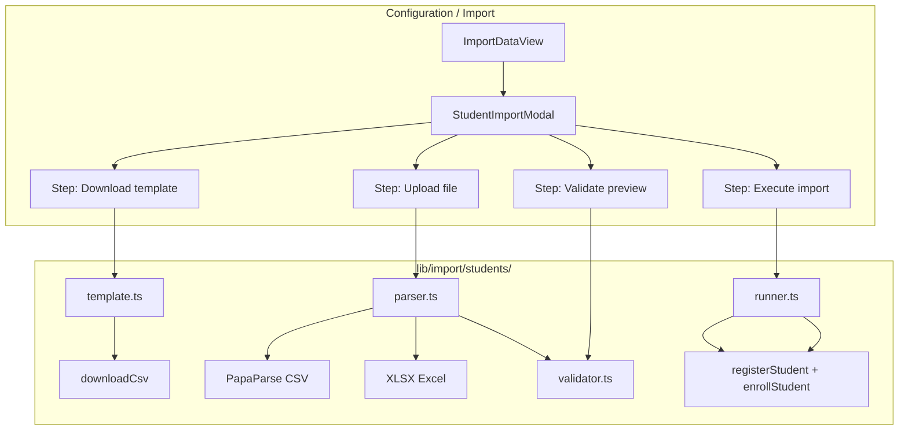

# Student Import — Client-Side Implementation Plan

> **Status:** Active  
> **Created:** 2026-07-11  
> **Scope:** Frontend only — no new backend endpoints  
> **Location:** Configuration → Import de données  
> **MVP pack:** Students (`.csv` + `.xlsx`)

---

## Goal

Allow school admins to bulk-import students from a spreadsheet without backend changes. The browser:

1. Offers a downloadable template
2. Accepts a filled `.csv` or `.xlsx` file
3. Parses and validates rows locally
4. Creates students via existing API commands (`registerStudent` + `enrollStudent`)

---

## Constraints

| Constraint | Decision |
|------------|----------|
| Backend changes | **None** — reuse `client.commands.registerStudent` and `client.commands.enrollStudent` |
| UI location | **Configuration tab** — new nav item `/configuration/import` |
| File formats | **`.csv`** and **`.xlsx`** |
| Volume target | 20–100 students (acceptable latency; sequential API calls) |
| Idempotency | Skip rows with duplicate matricule (if provided); no update in MVP |

---

## Architecture



### Reuse existing code

| Existing | Reuse for |
|----------|-----------|
| `lib/list/list-csv-export.ts` → `downloadCsv` | Template download |
| `routes/.../students-list-mutations.ts` → `createStudentOnPage` | Mutation pattern (IDs, payloads) |
| `lib/academic/context.svelte` → `academicContext.classes` | Class name → `classGroupId` resolution |
| `lib/components/ui/FormModal.svelte` + Dialog | Modal shell (or custom multi-step dialog) |
| `runStudentRouteMutation` pattern | Error handling + `entityVersions.bump` |

---

## CSV template spec (MVP)

**Filename:** `eleves-template.csv`

| Column | Required | Maps to | Notes |
|--------|----------|---------|-------|
| `prenom` | yes | `registerStudent.firstName` | trimmed |
| `nom` | yes | `registerStudent.lastName` | trimmed |
| `classe` | yes | resolved → `enrollStudent.classGroupId` | match by class display name |
| `date_naissance` | no | `registerStudent.birthDate` | `YYYY-MM-DD` |
| `genre` | no | deferred (phase 2: `updateStudentProfile`) | M/F or free text |
| `matricule` | no | deferred (phase 2) | uniqueness check against loaded roster |

**Example row (included in template):**

```csv
prenom,nom,classe,date_naissance,genre,matricule
Jean,Dupont,6ème A,2012-03-15,M,MAT-2024-001
```

**Class resolution:** case-insensitive trim match on `ClassNode.name` from `academicContext.classes`. On ambiguity, report error with suggestions.

---

## Dependencies to add

```bash
cd edaya_web/apps/webapp
bun add papaparse xlsx
bun add -D @types/papaparse
```

| Package | Role | Size note |
|---------|------|-----------|
| `papaparse` | Parse `.csv` in browser | ~45 KB gzip |
| `xlsx` (SheetJS) | Parse `.xlsx` → JSON rows | ~300 KB — acceptable for admin-only config screen |

---

## File structure

```
edaya_web/apps/webapp/src/
  lib/import/
    shared/
      file-accept.ts              # accept=".csv,.xlsx"
      normalize-header.ts         # trim + lowercase column names
      types.ts                    # ImportRowError, ImportValidationResult
    students/
      template.ts                 # columns + downloadStudentImportTemplate()
      parser.ts                   # parseStudentImportFile(file) → StudentImportRow[]
      validator.ts                # validateStudentImportRows(rows, classes, existingMatricules)
      runner.ts                   # runStudentImport(rows) → ImportRunResult
      types.ts                    # StudentImportRow

  lib/components/school/configuration/
    ImportDataView.svelte           # page: pack cards (students first)
    StudentImportModal.svelte       # 4-step wizard modal
    ImportFileDropzone.svelte       # drag-and-drop + file input
    ImportValidationTable.svelte    # row/column errors table
    ImportProgressBar.svelte        # execute step progress

  routes/(app)/configuration/import/
    +page.svelte

  lib/navigation/
    nav-catalog.ts                  # + import nav item
    navigation.ts                   # + CONFIG_ITEMS entry

  lib/i18n/dictionaries/
    fr.ts                           # import.* keys
    en.ts

tests/lib/import/students/
  parser.test.ts
  validator.test.ts
  runner.test.ts                    # mock API client
```

---

## Implementation phases

### Phase 0 — Scaffolding (0.5 day) ✅

| ID | Task | Files | Status |
|----|------|-------|--------|
| 0.1 | Add dependencies (`papaparse`, `xlsx`) | `package.json` | ✅ |
| 0.2 | Add nav item `config.import` → `/configuration/import` | `nav-catalog.ts`, `navigation.ts` | ✅ |
| 0.3 | Add i18n keys (fr + en) | `fr.ts`, `en.ts` | ✅ |
| 0.4 | Create route stub + `ImportDataView` with single "Students" card | `+page.svelte`, `ImportDataView.svelte` | ✅ |
| 0.5 | Gate with `PermissionGate` — `STUDENT_UPDATE` + `ENROLLMENT_CREATE` | `ImportDataView.svelte` | ✅ |

**Exit criteria:** `/configuration/import` renders; nav link visible for authorized users.

---

### Phase 1 — Template download (0.5 day) ✅

| ID | Task | Files | Status |
|----|------|-------|--------|
| 1.1 | Define `STUDENT_IMPORT_COLUMNS` constant | `students/types.ts` | ✅ |
| 1.2 | Implement `downloadStudentImportTemplate()` using `downloadCsv` | `students/template.ts` | ✅ |
| 1.3 | Wire download button in modal step 1 | `StudentImportModal.svelte` | ✅ |
| 1.4 | Show column legend + prerequisite hint ("classes must exist") | modal UI | ✅ |

**Exit criteria:** Clicking download produces `eleves-template.csv` with header + example row.

---

### Phase 2 — File parsing (1 day) ✅

| ID | Task | Files | Status |
|----|------|-------|--------|
| 2.1 | `normalizeHeader()` — trim, lowercase, strip BOM | `shared/normalize-header.ts` | ✅ |
| 2.2 | CSV parser via PapaParse | `students/parser.ts` | ✅ |
| 2.3 | XLSX parser via SheetJS | `students/parser.ts` | ✅ |
| 2.4 | `parseStudentImportFile(file)` — detect format by extension/MIME | `students/parser.ts` | ✅ |
| 2.5 | Map raw rows → `StudentImportRow` with `rowIndex` | `students/parser.ts` | ✅ |
| 2.6 | `ImportFileDropzone` — accept `.csv,.xlsx`, max 5 MB | `ImportFileDropzone.svelte` | ✅ |
| 2.7 | Unit tests: CSV parsing, XLSX parsing, header normalization | `parser.test.ts` | ✅ |

**Exit criteria:** Uploading sample `.csv` and `.xlsx` yields identical parsed row objects.

---

### Phase 3 — Validation (1 day) ✅

| ID | Task | Files | Status |
|----|------|-------|--------|
| 3.1 | Required field checks (`prenom`, `nom`, `classe`) | `students/validator.ts` | ✅ |
| 3.2 | Date format validation (`YYYY-MM-DD`) | `students/validator.ts` | ✅ |
| 3.3 | Class resolution against `academicContext.classes` | `students/validator.ts` | ✅ |
| 3.4 | Duplicate matricule within file | `students/validator.ts` | ✅ |
| 3.5 | Duplicate matricule against existing students | `load-existing-matricules.ts` | ✅ |
| 3.6 | Return `{ validRows, errors[], warnings[] }` | `students/validator.ts` | ✅ |
| 3.7 | `ImportValidationTable` — display errors by row/column | `ImportValidationTable.svelte` | ✅ |
| 3.8 | Unit tests for all validation rules | `validator.test.ts` | ✅ |

**Exit criteria:** Invalid files show blocking errors; valid files show preview count and enable import button.

---

### Phase 4 — Import execution (1 day) ✅

| ID | Task | Files | Status |
|----|------|-------|--------|
| 4.1 | Extract shared `registerAndEnrollStudent()` from `createStudentOnPage` logic | `register-and-enroll-student.ts`, `students-list-mutations.ts` | ✅ |
| 4.2 | Sequential loop with unique IDs: `stu-${Date.now().toString(36)}-${i}` | `students/runner.ts` | ✅ |
| 4.3 | Per-row try/catch — collect successes and failures, continue on error | `students/runner.ts` | ✅ |
| 4.4 | `entityVersions.bump(['students', 'enrollments'])` after batch | `students/runner.ts` | ✅ |
| 4.5 | `ImportProgressBar` — `current / total` during execution | `ImportProgressBar.svelte` | ✅ |
| 4.6 | Result summary: created / failed / skipped | `StudentImportModal.svelte` step 4 | ✅ |
| 4.7 | Link "Voir les élèves" → `/school/students` | `StudentImportModal.svelte` step 4 | ✅ |
| 4.8 | Unit test runner with mocked client | `runner.test.ts` | ✅ |

**Exit criteria:** 10-row test file creates 10 students enrolled in correct classes; partial failure report is accurate.

---

### Phase 5 — Modal wizard UX (1 day)

| ID | Task | Files |
|----|------|-------|
| 5.1 | `StudentImportModal` — 4 steps: download → upload → validate → execute | `StudentImportModal.svelte` |
| 5.2 | Step indicator (dots or breadcrumb) | modal |
| 5.3 | Disable "Import" when blocking errors > 0 | modal |
| 5.4 | Prerequisite banner on `ImportDataView` when `academicContext.classes.length === 0` | `ImportDataView.svelte` |
| 5.5 | Card disabled + link to `/configuration/classes` when no classes | `ImportDataView.svelte` |
| 5.6 | Reset state on modal close | modal |
| 5.7 | `data-testid` hooks for integration tests | modal, dropzone |

**Exit criteria:** Full happy path works end-to-end from Configuration tab.

---

### Phase 6 — Tests & polish (0.5 day)

| ID | Task |
|----|------|
| 6.1 | `bun test tests/lib/import/students/*` |
| 6.2 | Manual test matrix (see below) |
| 6.3 | `bun run lint && bun run check` |
| 6.4 | Update `remaining-work-plan.md` with completed track entry |

---

## UI spec — Configuration → Import

### Page: `/configuration/import`

```
┌─────────────────────────────────────────────────────────────┐
│ Import de données                                           │
│ Importez vos données en masse à partir de fichiers CSV      │
│ ou Excel.                                                   │
│                                                             │
│ Ordre recommandé : Classes → Élèves → Responsables          │
│                                                             │
│ ┌─────────────────────────────────────────────────────┐     │
│ │ 👥 Élèves                                           │     │
│ │ Inscrire des élèves dans l'année scolaire active.   │     │
│ │ Prérequis : classes configurées                     │     │
│ │ Formats : .csv, .xlsx                               │     │
│ │                              [Importer]             │     │
│ └─────────────────────────────────────────────────────┘     │
│                                                             │
│ (future packs: Responsables, Personnel — disabled cards)    │
└─────────────────────────────────────────────────────────────┘
```

### Modal: Student import (4 steps)

| Step | Title | Primary action | Secondary |
|------|-------|----------------|-----------|
| 1 | Télécharger le modèle | Suivant | Annuler |
| 2 | Déposer le fichier | Vérifier | Retour |
| 3 | Vérification | Importer N élèves | Retour |
| 4 | Résultat | Voir les élèves | Fermer |

---

## API calls per row (no new endpoints)

```ts
// Same as createStudentOnPage — 2 commands per student
await client.commands.registerStudent({
  id: studentId,
  schoolId,
  firstName,
  lastName,
  birthDate?,          // optional
  sendAccountInvitation: false,  // MVP: no invites on bulk import
  createdAt: now,
});
await client.commands.enrollStudent({
  id: enrollmentId,
  studentId,
  classGroupId,
  createdAt: now,
});
```

---

## Manual test matrix

| # | Scenario | Expected |
|---|----------|----------|
| T1 | Download template | Valid CSV with 6 columns + example |
| T2 | Upload valid `.csv` (5 rows) | 5 students created, enrolled |
| T3 | Upload same data as `.xlsx` | Same result as T2 |
| T4 | Unknown class name | Blocking error on row, import disabled |
| T5 | Missing `prenom` | Blocking error |
| T6 | Invalid date `32/13/2020` | Blocking error |
| T7 | Empty file | Parse error message |
| T8 | 50 rows | Progress bar; completes < 2 min on staging |
| T9 | Row 3 fails (duplicate matricule) | Rows 1–2 created, 3+ reported in summary |
| T10 | No classes in school | Card disabled, link to classes config |

---

## Risks & mitigations

| Risk | Mitigation |
|------|------------|
| Slow for large files | Show progress; document ~100 row soft limit in UI |
| Partial import (no transaction) | Clear summary; recommend small batches |
| Class name ambiguity | Exact match first; fuzzy suggestions in error message |
| XLSX bundle size | Import only on config route; Vite code-split modal |
| Colleague backend conflicts | Zero backend PRs; only `edaya_web` changes |

---

## Out of scope (MVP)

- Backend `/core/import/*` endpoints
- Guardian / staff import packs
- `updateStudentProfile` for genre/matricule post-create
- Excel export of error report
- Rollback / undo import
- Account invitations on bulk import

---

## Suggested PR breakdown

| PR | Content | Est. |
|----|---------|------|
| PR1 | Phase 0 + 1 — nav, page, template download | 0.5 d |
| PR2 | Phase 2 + 3 — parser + validator + tests | 1.5 d |
| PR3 | Phase 4 + 5 — runner + modal wizard | 2 d |
| PR4 | Phase 6 — polish, manual QA, docs | 0.5 d |

**Total estimate:** ~4.5 days

---

## Acceptance criteria (MVP done)

- [ ] `/configuration/import` accessible from Configuration nav
- [ ] Student card opens import modal
- [ ] Template downloads as `.csv`
- [ ] Upload accepts `.csv` and `.xlsx`
- [ ] Validation shows row-level errors before import
- [ ] Import creates students via existing API commands
- [ ] Progress and result summary displayed
- [ ] Unit tests pass for parser, validator, runner
- [ ] `bun run lint && bun run check` green
- [ ] No backend changes
