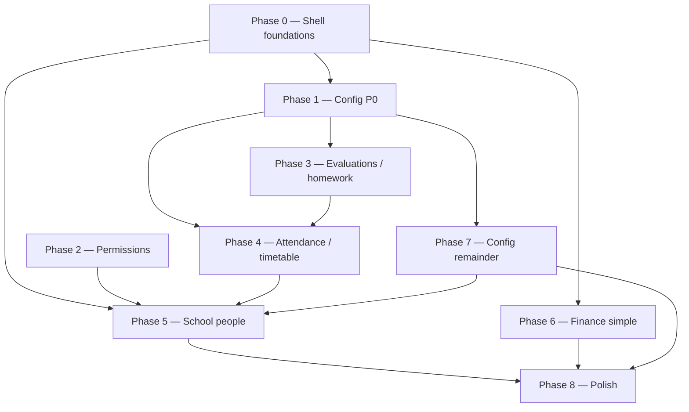

# V1 Staff Webapp — Implementation Plan

> **Status:** Phases 0–7 complete (2026-07-05) · Phase 8 next  
> **Created:** 2026-07-03  
> **Scope:** Bring `apps/webapp` to the target architecture in [v1-feature-architecture-spec.md](../specs/v1-feature-architecture-spec.md)  
> **Draft / detail catalog:** [ui-architecture-reference.md](../reference/ui-architecture-reference.md) — feature cards, entity audit, living §0 checklist  
> **Interaction & data:** [app-shell-spec.md](../specs/app-shell-spec.md) · [shared-components-spec.md](../specs/shared-components-spec.md) · [data-loading-spec.md](../specs/data-loading-spec.md) · [design-language-spec.md](../specs/design-language-spec.md)  
> **Backend:** All v1 UI blockers resolved (B1–B5 on dev Neon). Re-run `db:migrate:full` on staging/prod before permission work there.

---

## Progress tracker

Check off when the phase is complete and merged. Update [ui-architecture-reference.md §0](../reference/ui-architecture-reference.md#v1-progress-tracker) in the same PR.

- [x] **Phase 0** — Shell foundations (entity header · toolbar · shared primitives) — *(2026-07-03 — primitives + pilots: Guardian, Announcements, SchoolStudents, GradeScales)*
- [x] **Phase 1** — Configuration P0 (grade levels · classes drawer · staff assignments tab) — *(2026-07-03)*
- [x] **Phase 2** — Permissions migration (staff drawer · remove `/configuration/roles`) — *(2026-07-04 — CRUD on Staff → Permissions tab; roles nav removed; legacy URL redirects)*
- [x] **Phase 3** — Class academics refactor (homework fold · evaluations · `attendanceMode` nav) — *(2026-07-05 — unified evaluations list/drawer; homework route removed with redirect)*
- [x] **Phase 4** — Attendance & timetable (daily list · session flows · class activities) — *(2026-07-05 — daily attendance list/drawer; New session wizard; ClassActivityEnrollment; inline schedule on subject create; session attendance bulk)*
- [x] **Phase 5** — School people (student tabs · staff polish · incidents polish) — *(2026-07-05 — enrollments/grades/attendance tabs; staff header + RO assignments; incident filters, multi-student rows, sanctions)*
- [x] **Phase 6** — Finance simple entities (fees · payments · grade scales · notifications) — *(2026-07-05 — fees table + row menu; payments FilterSelect + receipt link; grade scales table + edit; notification templates row menu; BillingDetail header)*
- [x] **Phase 7** — Configuration remainder (disciplinary catalog · period definitions) — *(2026-07-05 — `/configuration/discipline` table + CRUD; period slots CRUD under academic accordion; calendar ListSearchField + status filter)*
- [ ] **Phase 8** — Polish & cleanup (filters · more menus · post-v1 nav removal)

### Already shipped (pre-plan)

- [x] **Incidents resolve** — `IncidentResolveModal` · `resolveIncidentWithOutcomes` (2026-07-03)
- [x] **Backend blockers B1–B5** — see [reference §6.1](../reference/ui-architecture-reference.md#61-backend-blockers)

---

## 1. Problem and goal

### Current situation

The staff webapp has working routes for most modules, but many screens predate the v1 architecture: footer-heavy drawers, chip-bar filters, dedicated homework nav, fees with drawers, and hardcoded `attendanceMode = session` on class create. *(Fixed: `/configuration/roles` matrix → Staff drawer Permissions tab, 2026-07-04.)*

### Product goal

Every in-scope screen matches the **normative** [v1-feature-architecture-spec.md](../specs/v1-feature-architecture-spec.md):

- Correct **surface type** (complex drawer · simple row menu · thin · layout)
- **Toolbar** contract: `[Primary CTA] [Search] [Main filter <select>] [Filter] [More]`
- **Drawer entity header** on complex entities (identity + up to 2 actions → modals)
- **Locked UX** respected (permissions on staff drawer, homework on evaluations, no roles route, etc.)

### Non-goals (v1)

- Resource management UI (`resources`, `resourceAssignments`)
- Occurrence-level staff assignment (lesson/session/subject targets)
- Dedicated exam menu or `/homework` route
- Bulk export implementation beyond stubs (More menu wiring only in Phase 8)

---

## 2. Prerequisites

| Prerequisite | Status | Action if missing |
|--------------|--------|-------------------|
| OpenAPI client (`classActivityEnrollments`, `resolveIncidentWithOutcomes`, auth entities) | ✅ dev | `EDAYA_CORE_ROOT=… bun run openapi:generate` after API changes |
| Permission DB cutover (staging/prod) | ✅ dev Neon | `bun run db:migrate:staging` on target env before Phase 2 in that env |
| Cursor rules + specs | ✅ | `.cursor/rules/v1-feature-architecture.mdc` · `app-shell.mdc` |

---

## 3. Cross-cutting patterns (apply in every phase)

Registry: [shared-components-spec.md](../specs/shared-components-spec.md). Interaction rules: [app-shell-spec.md](../specs/app-shell-spec.md).

### 3.1 Drawer entity header

Extract or extend a shared **`DrawerEntityHeader.svelte`** (or equivalent) used by all complex drawers:

- Avatar / photo · name · 1–3 status chips · one-line summary
- Up to **2 primary actions** → modals
- Destructive actions in overflow `···` only
- Remove footer Save/Cancel; Close in shell chrome only

**Acceptance:** No complex drawer uses `*Form.svelte` as default body; identity block is not duplicated in body tabs.

### 3.2 List toolbar

| Component | Rule |
|-----------|------|
| `ListPageHeader` | Primary CTA · search snippet · filters snippet · more snippet |
| `FilterSelect` | Main filter — always `<select>` |
| `FilterPanel` (or equivalent) | Secondary facets opened from Filter button |

**Acceptance:** No chip-bar or pill toggle as main filter on touched screens.

### 3.3 Data loading

Per [data-loading-spec.md](../specs/data-loading-spec.md):

- Route load via `query*Page` in `lib/queries/`
- Seed `detailDataContext` / entity store
- Mutations via `runMutation` with optimistic patch + rollback

### 3.4 Verification (each PR)

```sh
cd edaya_web
bun run check          # apps/webapp typecheck
bun run generated:check
bun --filter webapp test   # when tests touched
```

Manual: list → drawer URL → modal mutation → toast → drawer reflects change.

---

## 4. Phase details

### Phase 0 — Shell foundations

**Goal:** Shared primitives so later phases do not reinvent drawer headers and toolbars. Registry: [shared-components-spec.md §2–4](../specs/shared-components-spec.md#2-mandatory-registry-v1).

| ID | Task | Key files / areas | Done when |
|----|------|-------------------|-----------|
| 0.1 | Add `DrawerEntityHeader` (props: identity, actions, overflow) | `school/shared/DrawerEntityHeader.svelte` | Used by ≥1 pilot drawer |
| 0.2 | Add `ListSearchField` | `ui/ListSearchField.svelte` | Replaces inline search in ≥1 pilot list |
| 0.3 | Add `FilterPanel` | `ui/FilterPanel.svelte` | Secondary facets on ≥1 pilot list |
| 0.4 | Add `RowActionMenu` | `ui/RowActionMenu.svelte` | Used on ≥1 simple-entity list |
| 0.5 | Pilot `DrawerEntityHeader` on one complex drawer | e.g. Guardian or Announcement | Matches app-shell §3.1 |
| 0.6 | Document header migration list for remaining drawers | This plan §8 | Checklist complete |
| 0.7 | Audit main filters: list screens still using chip bars | `school/**` | Inventory in PR description |

**Chip-bar inventory (remaining — migrate in Phase 8 or when touching screen):**

| Screen | Chip facet |
|--------|------------|
| `ActivitiesView` | Category |
| `AnnouncementsView` | ~~Status~~ → `FilterSelect` ✅ |
| `ClassReportCardsView` | Status |
| `ConfigSubjectsView` | Scope |
| `EducatorDashboardView` | Event type |
| `FinanceView` | Status |
| `HomeworkView` | Status |
| `PaymentsView` | Method · status |
| `PlanningView` | Session kind |
| `ReportCardDefinitionsView` | Status |
| `ResourcesView` | Type |
| `SchoolCalendarView` | Event type |
| `SchoolStudentsView` | ~~Status~~ → `FilterPanel` ✅ |
| `StudentsView` | Status |

**Depends on:** —  
**Unlocks:** All complex-entity phases

---

### Phase 1 — Configuration P0

**Goal:** Grade levels route + URL-backed classes config drawer with class-level staff assignments and `attendanceMode`.

| ID | Task | Spec ref | Key work | Done when |
|----|------|----------|----------|-----------|
| 1.1 | **Grade levels** route + list + drawer | §7.20 | New `configuration/grade-levels/[[id]]` · `GradeLevelsView` · `GradeLevelDetail` · `queryGradeLevelsPage` | CRUD via modals; URL drawer |
| 1.2 | **Classes config** → URL-backed drawer | §7.21 | Refactor `configuration/classes` from row modal to `[[id]]` drawer | Row click opens drawer URL |
| 1.3 | Class profile: **`attendanceMode`** + **`homeroomStaffId`** | §5.1 | Class form modal / drawer profile section; stop hardcoding `session` on create | Field persists via entity save |
| 1.4 | **Staff assignments** tab (class-level only) | §4 locked | Sub-collection `staffAssignments` filtered by `classGroupId`; add/edit modal | Tab in classes drawer |
| 1.5 | Wire `CLASS_NAV_DEFS` to loaded class `attendanceMode` | §2.2 | `app-navigation` / class nav defs | Attendance tab hidden when `session` |

**API:** `gradeLevels` · `classGroups` · `staffAssignments` entity CRUD  
**Reference cards:** [Grade levels Planned](../reference/ui-architecture-reference.md#grade-levels-planned) · [Classes config Partial](../reference/ui-architecture-reference.md#35-configuration)

---

### Phase 2 — Permissions migration

**Goal:** Move permission management from `/configuration/roles` to Staff drawer; delete legacy route.

| ID | Task | Spec ref | Key work | Done when |
|----|------|----------|----------|-----------|
| 2.1 | Staff drawer **Permissions** tab | §7.4 | `StaffTabs` or `StaffDetail` tab · list `staffPermissionAssignments` | Add/edit/remove via modals |
| 2.2 | Permission picker integration | §5.3 | `loadPermissionCatalog` · `scope/render` for labels | Scope IDs built client-side |
| 2.3 | **Remove** `/configuration/roles` | §1.3 | Delete route, nav entry, `detail-routes`, redirects | No links to roles matrix |
| 2.4 | Configuration nav cleanup | §7.4 | Update config sidebar / breadcrumbs | Staff permissions discoverable from Staff module |

**API:** `staffPermissionAssignments` · `GET authorization/permission-catalog` · `POST authorization/scope/render`  
**Env:** Staging/prod DB on permission model (B2)

---

### Phase 3 — Class academics refactor

**Goal:** Single evaluations surface for all assessment kinds; remove homework nav.

| ID | Task | Spec ref | Key work | Done when |
|----|------|----------|----------|-----------|
| 3.1 | **Remove** `/homework` route + class nav tab | §1.3 | Delete `homework/[[id]]` · nav defs · `detail-hrefs` | Redirect or 404 with no nav link |
| 3.2 | Evaluations list: **kind** main filter `<select>` | §7.12 | `evaluations` view — all / homework / quiz / project / other | Filter works |
| 3.3 | Row **kind badge** on assessment cards/rows | §7.12 | List item component | Badge per `assessment.kind` |
| 3.4 | Assessment drawer: **exclusive body** by `kind` | §7.12 | Homework → submissions; else grades grid | One section visible |
| 3.5 | New assessment modal: kind picker + optional timetable | §7.12 | Extend create modal | Non-homework can schedule |
| 3.6 | Migrate homework mutations/routes to evaluations | §7.12 | `homework.mutations.ts` callers updated | No orphan homework-only screens |

**API:** `assessments` · `assessmentResults` · `createSchedule` / `materializeSchedule` (optional inline)

---

### Phase 4 — Attendance & timetable

**Goal:** Daily attendance screen; timetable session wizard; class activity on grid.

| ID | Task | Spec ref | Key work | Done when |
|----|------|----------|----------|-----------|
| 4.1 | **Daily attendance** list (days) + drawer | §7.14 | New `classes/{id}/attendance/[[id]]` · day rows not student matrix | Nav visible only if `daily` |
| 4.2 | Day drawer: attendance records sub-collection | §7.14 | Mirror timetable session drawer pattern | `record-class-daily-attendance` / single |
| 4.3 | Timetable **New session** wizard | §7.10 | Lesson · Activity · Assessment paths → schedule materialize | CTA on timetable |
| 4.4 | **ClassActivityEnrollment** on timetable / activity flows | §4 locked | Link activity ↔ class for grid occurrences | `classActivityEnrollments` CRUD |
| 4.5 | Inline schedule from Lessons / Activities / Assessments | §7.10–7.12 | Optional fields on create/edit modals | Creates schedule when checked |
| 4.6 | Timetable drawer: session attendance tab polish | §7.10 | Align with daily drawer pattern | Session-mode classes |

**API:** `attendances` · `attendance` · `record-class-daily-attendance` · `classActivityEnrollments` · scheduling commands

---

### Phase 5 — School people

**Goal:** Student 360 tabs; staff drawer completion; incidents list/drawer polish.

| ID | Task | Spec ref | Key work | Done when |
|----|------|----------|----------|-----------|
| 5.1 | Student **Enrollments** tab (history) | §7.2 | `enrollments` list in drawer tab | Read-only list + modals if needed |
| 5.2 | Student **Grades** tab → links to evaluations | §7.2 | Deep-link `/classes/{classId}/evaluations/{id}` | Read-only links |
| 5.3 | Student **Attendance** tab (mode-agnostic) | §7.2 | Aggregate daily + session `AttendanceRecord` | Single tab all anchors |
| 5.4 | Staff drawer: entity header + assignments read-only summary | §7.4 | Phase 0 header + tab content | Matches spec |
| 5.5 | Incidents: **resolution status** filter | §7.8 | Filter panel on events list | Filter works |
| 5.6 | Incidents: multi-student list representation | §7.8 | `mapIncidents` / list row — show primary + count or labels | Not single-student only |
| 5.7 | Incidents: **sanctions** sub-collection in drawer | §7.8 | `studentDisciplinaryActions` for incident | Read-only after resolve |
| 5.8 | Incidents: entity header migration | §7.8 | `IncidentDetail` uses `DrawerEntityHeader` | Phase 0 pattern |

**API:** `enrollments` · `attendance` · `studentDisciplinaryActions` · incidents (existing)

---

### Phase 6 — Finance simple entities

**Goal:** Fees, payments, grade scales, notification templates use row `···` only — no drawers / inline card edit.

| ID | Task | Spec ref | Key work | Done when |
|----|------|----------|----------|-----------|
| 6.1 | **Fees** — remove drawer; row `···` menu | §7.15 | `FeesView` refactor | Edit/delete via modals only |
| 6.2 | **Payments** — row menu; receipt → billing drawer | §7.17 | Link to `/finance/billing/{id}` | No payment detail drawer |
| 6.3 | **Grade scales** — row menu; remove inline card edit | §7.24 | Configuration grade scales view | Simple entity pattern |
| 6.4 | **Notification templates** — row edit → modal | §7.25 | Remove inline edit if present | Modal-only edits |

**Billing** stays complex drawer (no change beyond header migration in Phase 0 rollout).

---

### Phase 7 — Configuration remainder

**Goal:** Disciplinary catalog + academic period definition admin.

| ID | Task | Spec ref | Key work | Done when |
|----|------|----------|----------|-----------|
| 7.1 | **Disciplinary catalog** simple list | §7.26 | New `/configuration/discipline` · row `···` | `disciplinaryActions` CRUD |
| 7.2 | **Period definitions** CRUD | §7.19 | Modals under academic calendar accordion | `periodDefinitions` entity |
| 7.3 | Academic calendar: main filter + search if missing | §7.19 | Toolbar alignment | Phase 0 toolbar rules |

**Unlocks:** Full incident sanction catalog UX (already loads in resolve modal)

---

### Phase 8 — Polish & cleanup

**Goal:** Secondary filters, More menus, nav cleanup, drawer header rollout completion.

| ID | Task | Key work | Done when |
|----|------|----------|-----------|
| 8.1 | **Filter** button wired on all list pages (secondary facets) | Per-feature filter panels | No empty Filter buttons |
| 8.2 | **More** menu stubs (export labels; disabled or toast) | Consistent menu presence | Per reference §3 cards |
| 8.3 | **Drawer entity header** on all remaining complex drawers | §8 migration list | 100% complex drawers |
| 8.4 | Remove **resources** from v1 nav (if still present) | Post-v1 cleanup | No resource nav items |
| 8.5 | Optional: dashboard daily attendance nudge | §6 P2 optional | Homeroom unmarked classes |

---

## 5. Dependency graph



**Recommended serial order:** `0 → 1 → 2 → 3 → 4 → 5 → 6 → 7 → 8`  
**Parallelizable after Phase 0:** Phase 6 (finance) can run parallel to Phase 3–4 if staffed.

---

## 6. Drawer entity header rollout

Migrate complex drawers to `DrawerEntityHeader` (Phase 0). Track here; move rows to Done in PRs.

| Drawer | Module | Phase |
|--------|--------|-------|
| `StudentTabs` / student detail | School · Classes | 5 |
| `StaffDetail` | School | 2, 5 |
| `GuardianDetail` | School | 0 pilot or 5 |
| `IncidentDetail` | School | 5 |
| `ActivityDetail` | School | 5 |
| `AnnouncementDetail` | School | 0 pilot or 5 |
| `AssessmentDetail` | Classes | 3 |
| `PlanningDetail` (timetable) | Classes | 4 |
| `ClassSubjectDetail` (teaching) | Classes | 4 |
| `ReportCardDetail` | Classes | 5 |
| `AttendanceDayDetail` (new) | Classes | 4 |
| `BillingDetail` | Finance | 6 ✅ |
| `ClassGroupDetail` (config) | Configuration | 1 |
| `GradeLevelDetail` (new) | Configuration | 1 |
| `ClassSubjectCatalogDetail` | Configuration | 8 |
| `ReportCardModelDetail` | Configuration | 8 |

Thin drawers (calendar, inbox): lighter header — sections only per spec.

---

## 7. Route & nav changes summary

| Action | Route / nav | Phase | Status |
|--------|-------------|-------|--------|
| **Add** | `/configuration/grade-levels/[[id]]` | 1 | ✅ |
| **Add** | `/configuration/discipline` | 7 | |
| **Add** | `/classes/{classId}/attendance/[[id]]` (conditional nav) | 4 | nav ✅ · list UI Phase 4 |
| **Refactor** | `/configuration/classes` → `[[id]]` drawer | 1 | ✅ |
| **Refactor** | `/finance/fees` → simple list (no `[[id]]` drawer) | 6 | ✅ |
| **Remove** | `/configuration/roles` | 2 | ✅ *(redirect → `/school/staff/{id}`)* |
| **Remove** | `/classes/{classId}/homework/[[id]]` + nav tab | 3 | ✅ *(redirect → evaluations)* |
| **Keep** | `/classes/{classId}/evaluations/[[id]]` (all kinds) | 3 | ✅ |

---

## 8. Definition of done (v1 complete)

The v1 staff webapp implementation is **complete** when:

1. All phases **0–8** checked off in this document and [reference §0](../reference/ui-architecture-reference.md#v1-progress-tracker).
2. Every route in [v1 spec §6](../specs/v1-feature-architecture-spec.md#6-route-index) exists with correct surface type.
3. No removed routes (`/configuration/roles`, `/homework`) remain in nav or routing.
4. `bun run check` and `bun run generated:check` pass on `edaya_web`.
5. Spot-check: Configuration → Classes → staff tab · Staff → Permissions · Evaluations with homework kind · Daily attendance on a `daily` class · Incident resolve modal.

---

## 9. Document maintenance

| When | Update |
|------|--------|
| Phase completes | Check box here + [reference §0](../reference/ui-architecture-reference.md#v1-progress-tracker) |
| Feature reaches **Built** | Update status in reference §3 feature cards |
| Architecture decision changes | [v1-feature-architecture-spec.md](../specs/v1-feature-architecture-spec.md) first, then this plan |
| New backend blocker | Add to reference §6.1; add prerequisite row in §2 here |

---

## Document history

| Date | Change |
|------|--------|
| 2026-07-05 | Phase 6 checked off — fees/payments simple lists, grade scales table, notification row menu, billing header |
| 2026-07-05 | Phase 5 checked off — student drawer tabs, staff header/assignments, incidents polish |
| 2026-07-05 | Phase 4 checked off — daily attendance, session wizard, ClassActivityEnrollment |
| 2026-07-04 | Phases 0–2 checked off; route table updated (grade levels, classes drawer, roles removal) |
| 2026-07-03 | Initial plan from ui-architecture-reference + v1-feature-architecture-spec |
